# Harness engineering workshop

Restored original sequence, including original reserves. No slides have been deleted in this review.

[Open the visual review](http://localhost:5173/s/odsc-full-visual-review?p=1) · [Suggested cuts and source checks](review-additions/original-sequence-review.md)

Edit headings and visible body directly. `review-note` comments appear on the visual slide. Suggested cuts require Rajiv’s decision. Original annotated text and previous drafts are preserved in the archive. Speaker details are in [talk-track.md](talk-track.md).

---

---

---
# Opening

---
<!-- source-slide: 001 -->
<!-- review-layout: text -->
## Engineering the Harness: A Practical Workshop

Rajiv Shah · OpenHands

Source: [Workshop repository](https://github.com/rajshah4/harness-engineering)

---
<!-- source-slide: 003 -->
<!-- review-layout: figure -->
## We have moved beyond tab completion

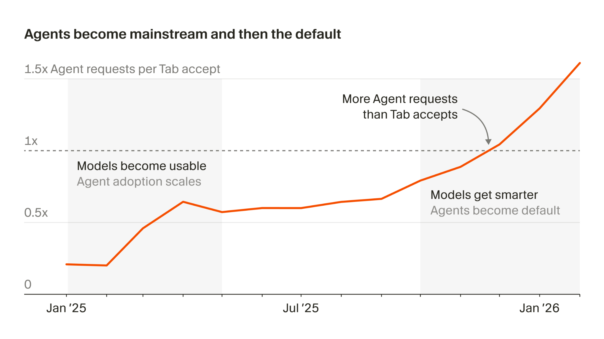

Cursor users made more agent requests than autocomplete accepts: developers were delegating tasks, not just accepting code suggestions.

Source: [https://prod.cursor.com/blog/third-era](https://prod.cursor.com/blog/third-era)

---
<!-- source-slide: 004 -->
<!-- review-layout: figure -->
## Agent = model + harness

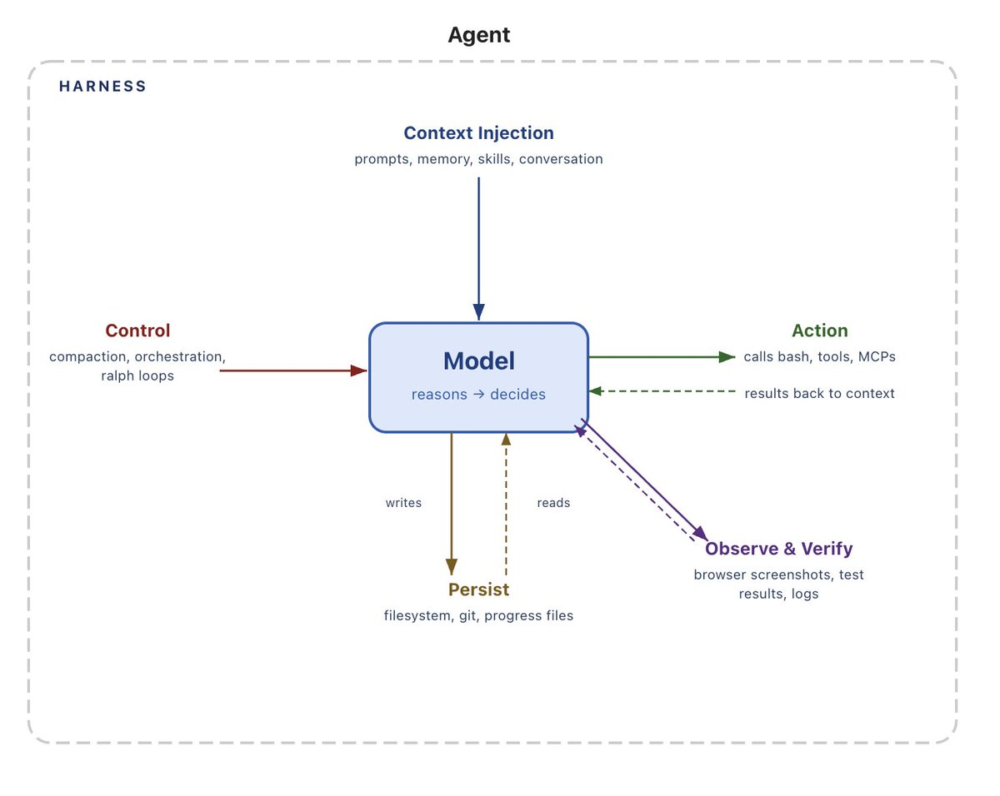

The model requests an action. The harness supplies context, executes the tool, and returns the result.

Source: [https://blog.langchain.com/the-anatomy-of-an-agent-harness/](https://blog.langchain.com/the-anatomy-of-an-agent-harness/)

---
<!-- new-slide: agent-canvas-run -->
<!-- review-layout: figure -->
## What an agent does

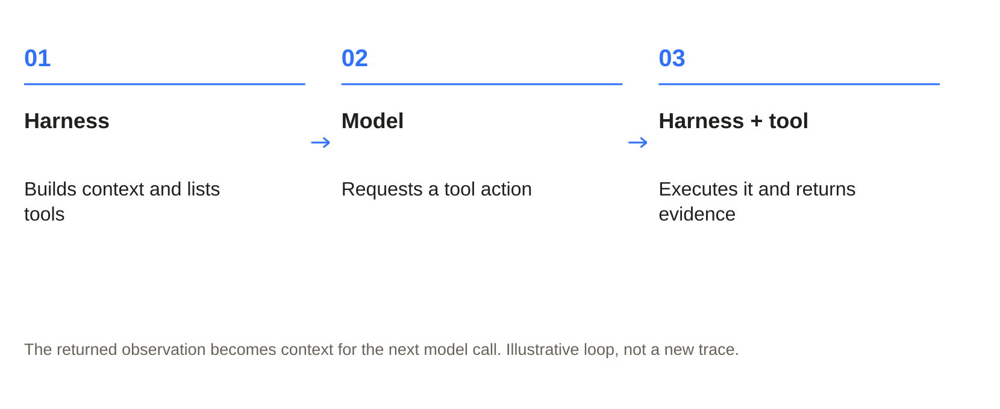

A tool result becomes input to the next model call. The trace records that exchange.

Source: [Saved event IDs and excerpts](review-additions/trace-evidence.md). Selected events from the Aug. 24 Incident Operations Center run; intermediate edits are omitted.

---
<!-- source-slide: 006 -->
<!-- review-layout: figure -->
## What is in a harness

Instructions, tools, context management, execution, and stopping rules all sit outside the model.

Source: [https://blog.langchain.com/the-anatomy-of-an-agent-harness/](https://blog.langchain.com/the-anatomy-of-an-agent-harness/)

---
<!-- source-slide: 057 -->
<!-- review-layout: figure -->
## Harnesses get complicated quickly

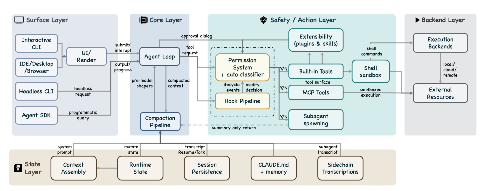

A modern coding agent includes much more than the model and a tool-call loop.

Source: [https://arxiv.org/pdf/2604.14228](https://arxiv.org/pdf/2604.14228)

---
<!-- source-slide: 008 -->
<!-- review-note: Review source: verify the dated survey figures before presenting. -->
<!-- review-layout: table -->
## Rise of Claude Code and Codex

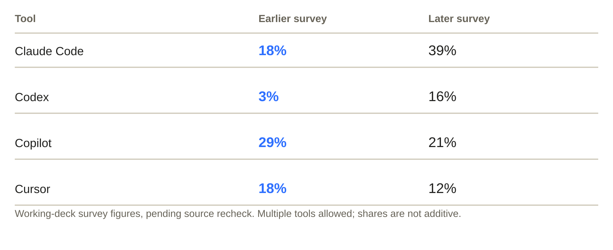

Multiple selections allowed; survey percentages are not additive.

---
<!-- source-slide: 009 -->
<!-- review-note: Review source: archived GitHub star counts need a dated check. -->
<!-- review-layout: table -->
## Harnesses from model providers

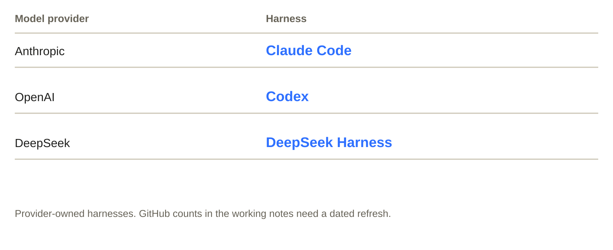

Each provider ships a coding harness with its own tools, context policies, and execution controls.

---
<!-- source-slide: 010 -->
<!-- review-layout: figure-caption -->
## Provider harnesses are a good starting point

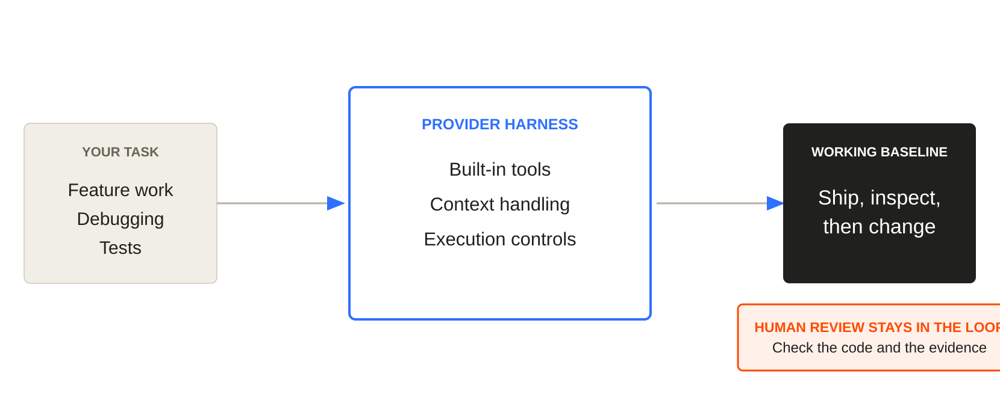

Claude Code and Codex handle feature work, debugging, refactoring, and tests.

Anthropic observed 67% more merged PRs per engineer per day after adopting Claude Code. Internal observation, with human review.

Source: [OpenAI, Codex engineering workflows, September 2025](https://openai.com/index/introducing-upgrades-to-codex/) · [Anthropic, internal engineering study, December 2025](https://www.anthropic.com/research/how-ai-is-transforming-work-at-anthropic)

---
<!-- new-slide: why-alternatives -->
<!-- review-layout: figure-caption -->
## What you can change in a harness

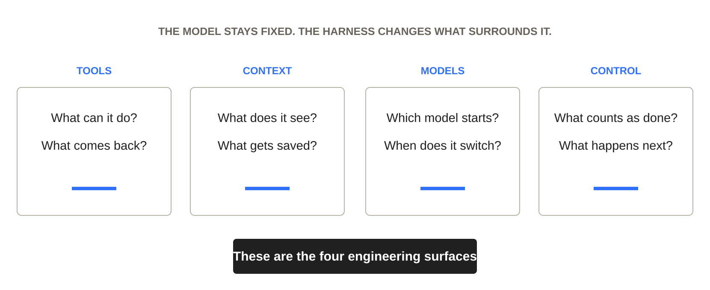

Provider defaults can miss requirements or repeat work. Tools, context, model choice, and control are the four places we can change the behavior.

---
<!-- source-slide: 091 -->
<!-- review-layout: figure-caption -->
## Consequences of a closed harness

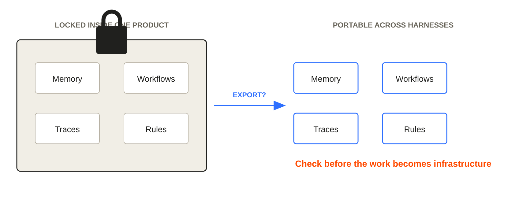

A closed harness can lock you into its memory and workflows. Check whether you can export and reuse them elsewhere.

Source: [LangChain, Your harness, your memory](https://www.langchain.com/blog/your-harness-your-memory) · [Sarah Wooders, original post linked by LangChain](https://x.com/sarahwooders/status/2040121230473457921)

---
<!-- new-slide: existing-harness-starting-point -->
<!-- review-layout: figure-caption -->

## Workshop roadmap: inside the harness

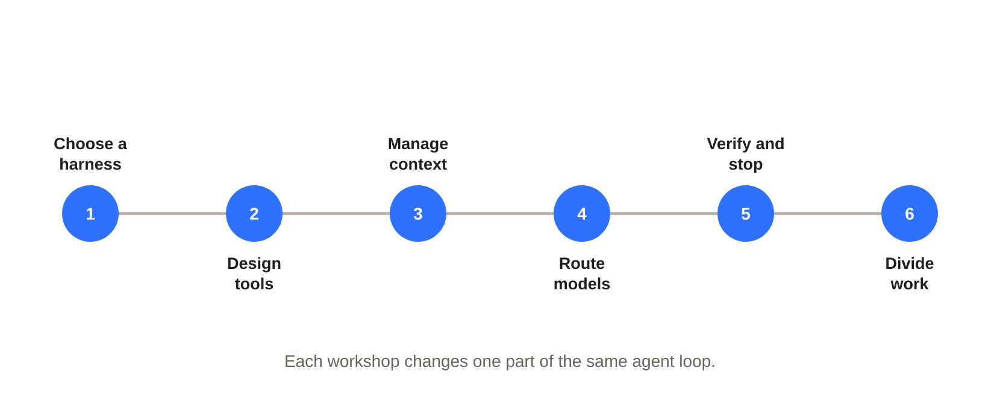

Each workshop changes one part of the same agent loop, then checks what changed in the trace and result.

---
# Workshop 1: Harness choice

---
<!-- new-slide: workshop-1-section -->
<!-- review-layout: section -->
## Workshop 1: Harness choice

We will hold the task fixed and inspect what each harness changes.

---
<!-- new-slide: workshop-setup -->
<!-- review-layout: figure-caption -->
## Workshop environment and fallback path

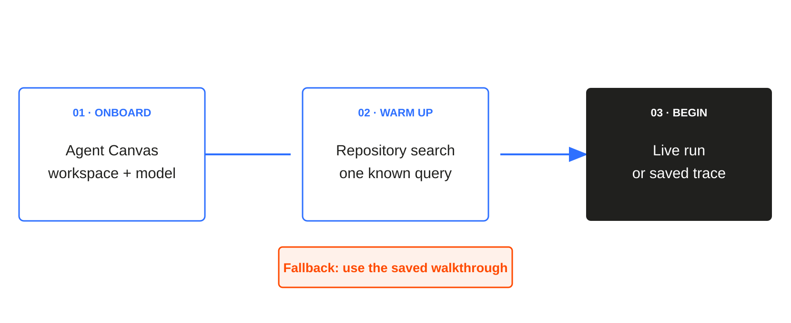

Open the quickstart and complete Agent Canvas onboarding.

Check the workspace, model, and provider; run the repository-search warmup.

If setup is incomplete, follow the saved-trace walkthrough.

Source: [Workshop quickstart](https://github.com/rajshah4/learn-openhands-harness/blob/main/01-quickstart.md) · [Repository-search warmup](https://github.com/rajshah4/learn-openhands-harness/blob/main/02-harness-tour.md)

---
<!-- source-slide: 013 -->
<!-- review-layout: figure-caption -->
## Harness comparison: the same task across three systems

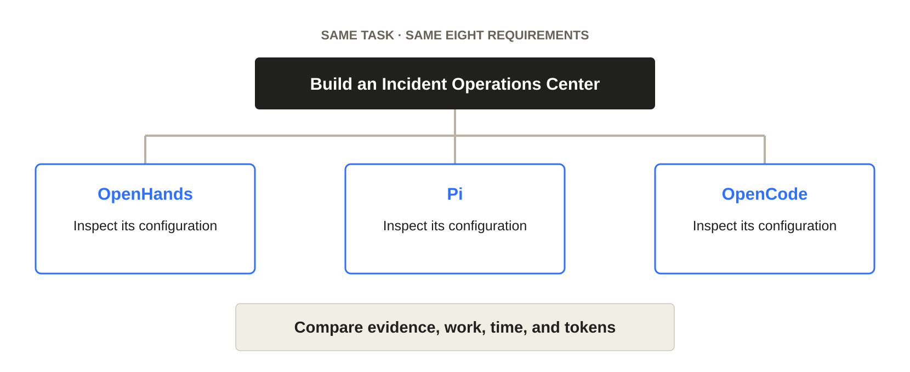

Build an Incident Operations Center against eight requirements.

Compare the saved OpenHands, Pi, and OpenCode runs. Check their configurations before attributing differences to the harness.

---
<!-- source-slide: 025 -->
<!-- review-layout: figure -->
## Trace one decision to the harness

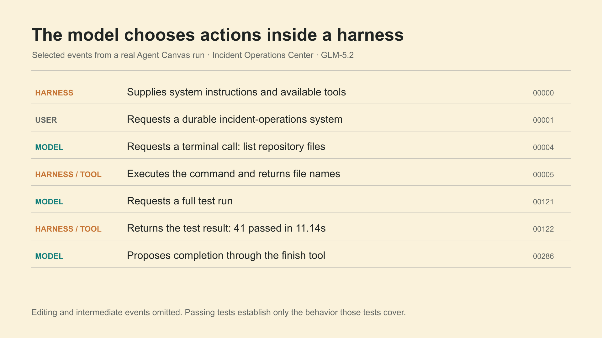

Trace one request through tool execution and the returned result. Identify the configuration responsible for that behavior.

Source: [Saved event IDs and excerpts](review-additions/trace-evidence.md)

---
<!-- source-slide: 026 -->
<!-- review-layout: figure-caption -->
## Completion scores hid large differences in work

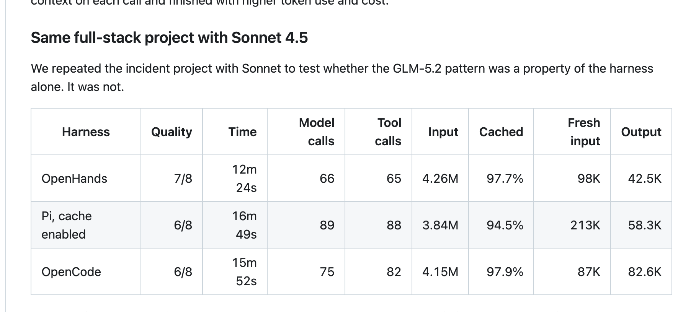

Similar completion scores can require very different amounts of work.

---
<!-- new-slide: pi-cache-intervention -->
<!-- review-layout: figure -->
## Provider caching cut Pi's fresh input from 3.35M to 213K tokens

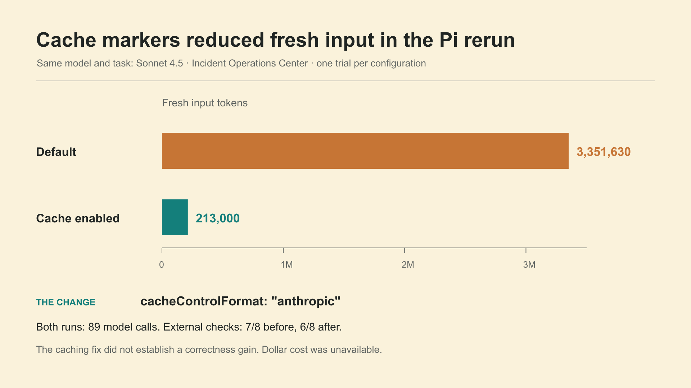

Setting `cacheControlFormat: "anthropic"` enabled provider cache reads. Both runs made 89 model calls.

The checks differed, 7/8 versus 6/8. These separate trajectories do not establish a quality effect from caching.

Source: [Pi cache-control experiment](../../../harness-benchmark/results/incident-sonnet-harness-comparison.md)

---
<!-- new-slide: agentic-loop-transcript-growth -->
<!-- review-layout: figure-full -->
## Every agent turn resends the transcript so far

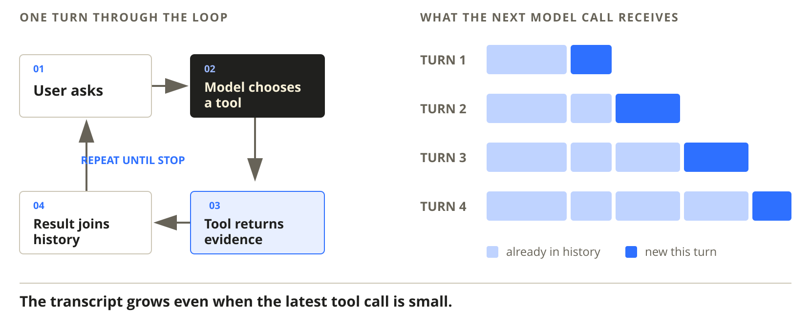

Source: Together AI, Open Source AI Summit 2026, slide 16. Redrawn from the supplied screenshot.

---
<!-- new-slide: prefix-cache-prefill -->
<!-- review-layout: figure-full -->
## Prefix caching reuses the shared transcript

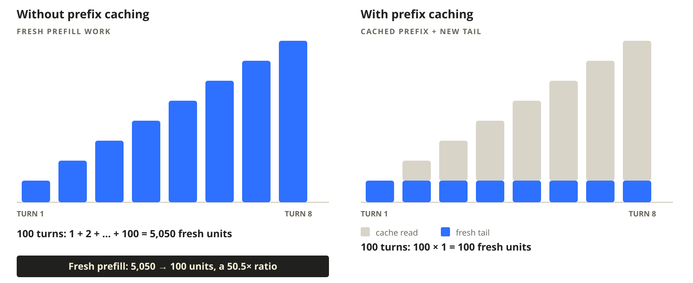

Source: Together AI, Open Source AI Summit 2026, slide 17. Redrawn. Equal-size-turn illustration.

---
<!-- source-slide: 017 -->
<!-- review-layout: figure -->
## An 18-point spread with the same model

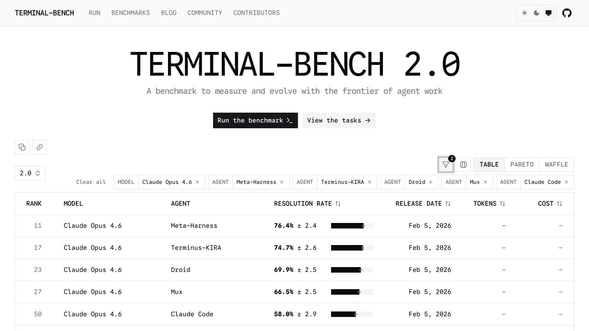

---
<!-- source-slide: 019 -->
<!-- review-layout: figure -->
## Harnesses varied on accuracy, time, and token use

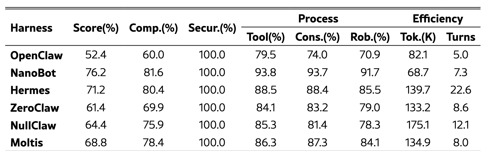

Completion score alone misses differences in process quality, time, and token use.

---
<!-- source-slide: 018 -->
<!-- review-layout: figure -->
## No harness led on every measure

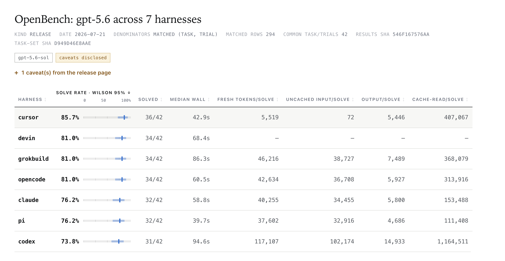

---
<!-- new-slide: deepseek-harness-configurations -->
<!-- review-layout: table -->
## DeepSeek favored a simpler harness in this comparison

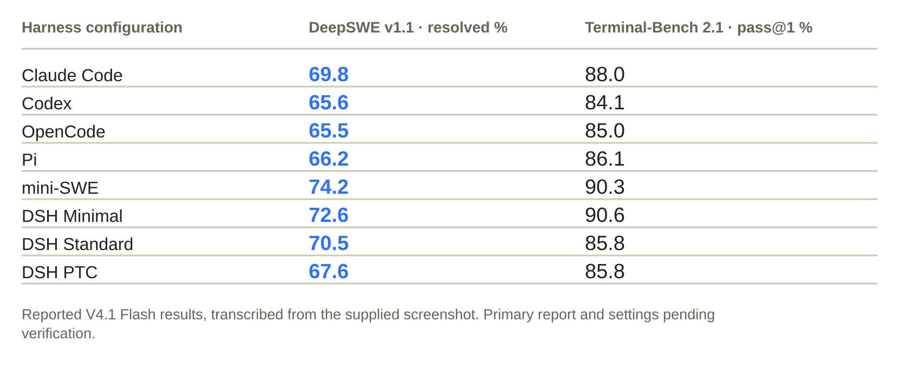

Source: [Supplied @zainhas screenshot](../open-slide-deck/slides/odsc-full-visual-review/assets/deepseek-benchmark-source-screenshot.png), September 10, 2026. Primary release report pending verification.

---
<!-- source-slide: 016 -->
<!-- review-layout: figure -->
## Snowflake's CoCo scored higher at lower cost

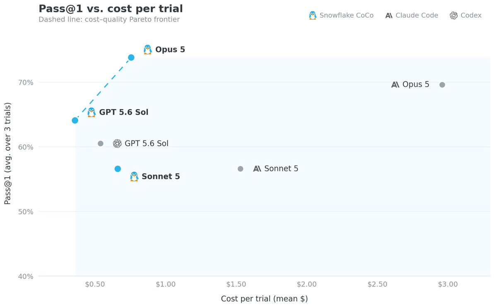

---
<!-- new-slide: harvey-harness-result -->
<!-- review-layout: figure-caption -->
## Harvey reported 23.3% to 62.4% across two review setups

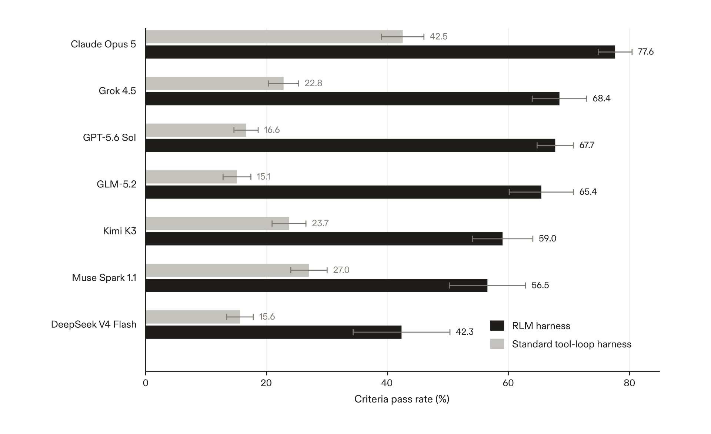

Source: [Harvey and Baseten, September 8, 2026](https://www.harvey.ai/blog/post-training-rlm-agents-for-m-and-a-diligence), Figure 6. Vendor-reported LLM judging against expert rubrics. RLM uses fixed Qwen3.6-35B-A3B subagents. This is not an equal-compute comparison.

---
<!-- new-slide: harvey-harness-mechanism -->
<!-- review-layout: figure -->
## Harvey used a Python REPL and bounded subagents

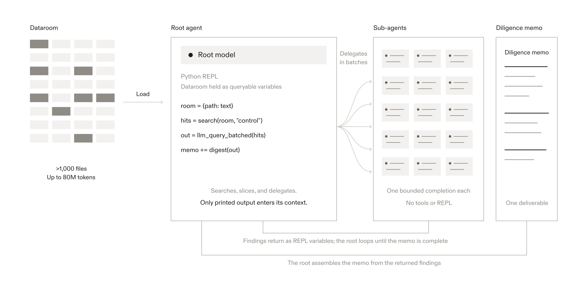

Bounded subagents review documents through a Python REPL and return selected evidence to the root agent.

Source: [Harvey and Baseten](https://www.harvey.ai/blog/post-training-rlm-agents-for-m-and-a-diligence), Figure 5.

---
<!-- new-slide: domain-specific-harnesses -->
<!-- review-layout: figure-full -->
## “Everyone is building a domain-specific harness”

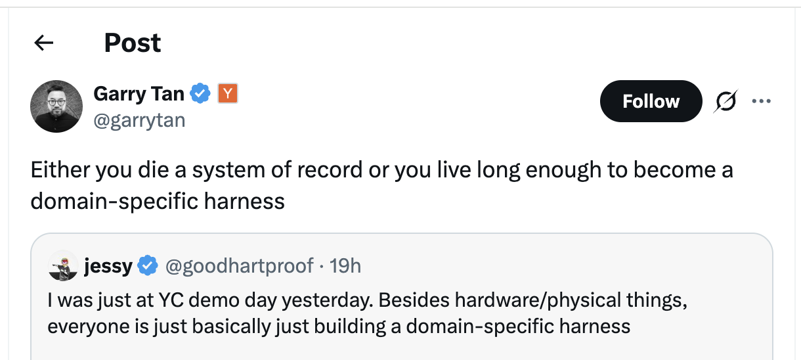

Source: [Garry Tan on X, screenshot supplied by Rajiv](review-additions/social-posts/garry-tan-domain-specific-harness.png)

---
<!-- new-slide: model-improvement-retest -->
<!-- review-layout: figure-caption -->
## A stronger model erased the hand-built agent's advantage

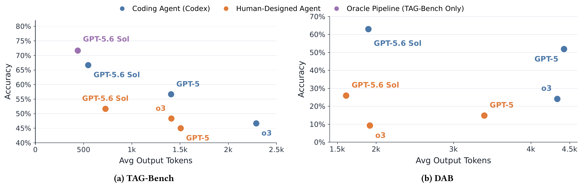

Source: [Patel et al., What Happens When the Model Eats the Stack?](https://arxiv.org/pdf/2609.03141), Figure 1. TAG-Bench uses a partial reconstruction of the custom agent.

---
<!-- source-slide: 058 -->
<!-- review-layout: figure -->
## Harness changes can reduce quality

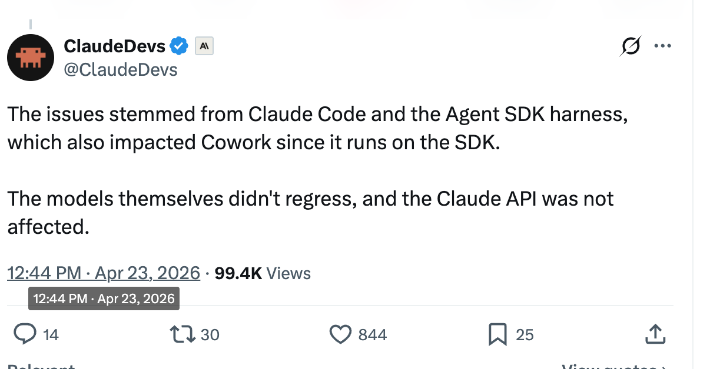

Lower reasoning effort, lost thinking blocks, and shorter-response instructions each featured in Anthropic’s quality postmortem.

Source: [https://www.anthropic.com/engineering/april-23-postmortem](https://www.anthropic.com/engineering/april-23-postmortem)

---
<!-- source-slide: 022 -->
<!-- review-layout: table -->
## Open-source harnesses offer different starting points

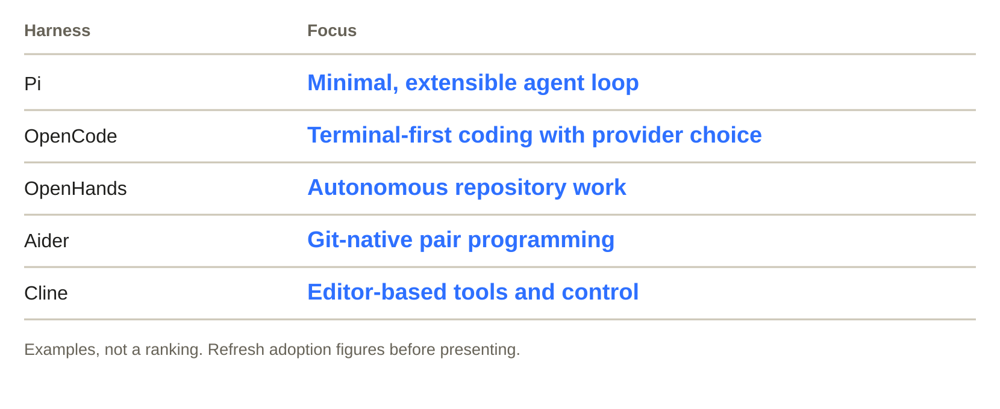

Existing projects offer different tool interfaces, model choices, and extension points.

---
<!-- source-slide: 024 -->
<!-- review-layout: figure-full -->
## Different harnesses make different engineering choices

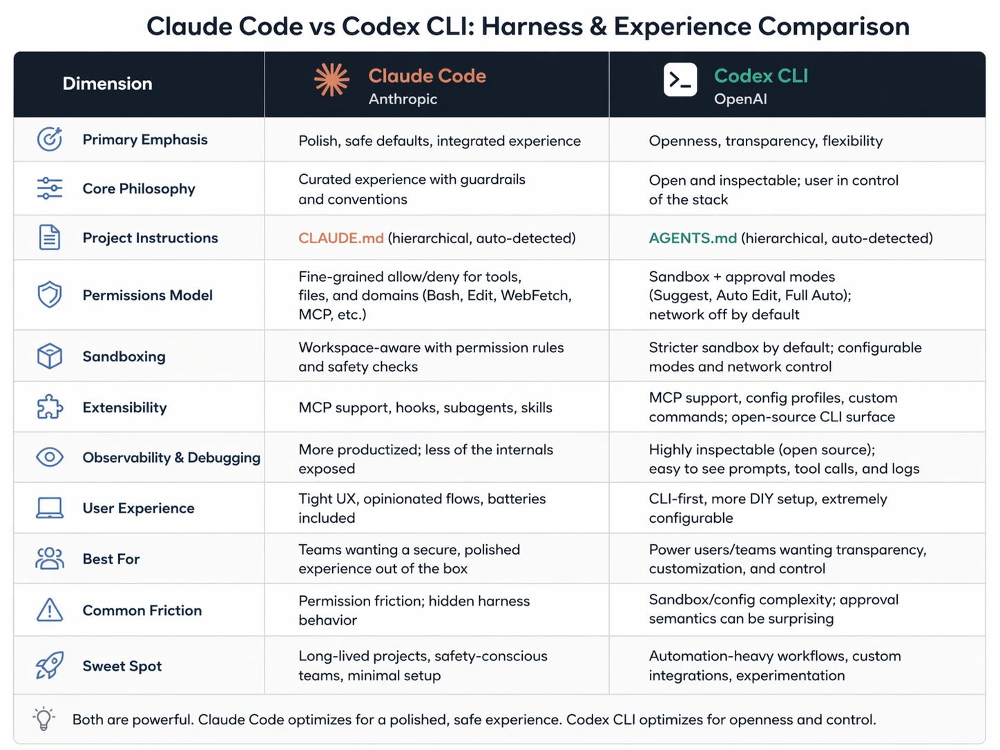

Source: [https://fieldjournal.ai/blog/codex-cli-vs-claude-code/?utm_source=chatgpt.com](https://fieldjournal.ai/blog/codex-cli-vs-claude-code/?utm_source=chatgpt.com)

---
<!-- source-slide: 015 -->
<!-- review-layout: figure -->
## Tools and feedback in SWE-agent

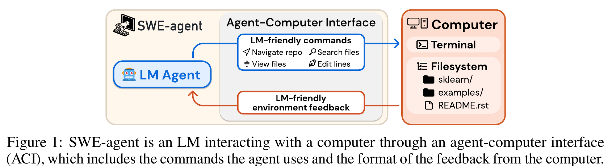

The model needs usable tools and informative feedback to choose its next action. That is the next harness decision we will inspect.

---
# Workshop 2: Tool design

---
<!-- new-slide: workshop-2-section -->
<!-- review-layout: section -->
## Workshop 2: Tool design

We will compare what the model can request, what one call can do, and what evidence comes back.

---
<!-- source-slide: 029 -->
<!-- review-layout: figure-caption -->
## A tool controls the action and the evidence

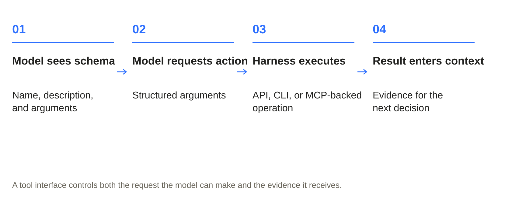

A tool controls both the action the model can request and the evidence returned for its next decision.

---
<!-- new-slide: workshop-2-intro -->
<!-- review-layout: figure-caption -->
## Workshop 2: Which tool interface would you give the agent?

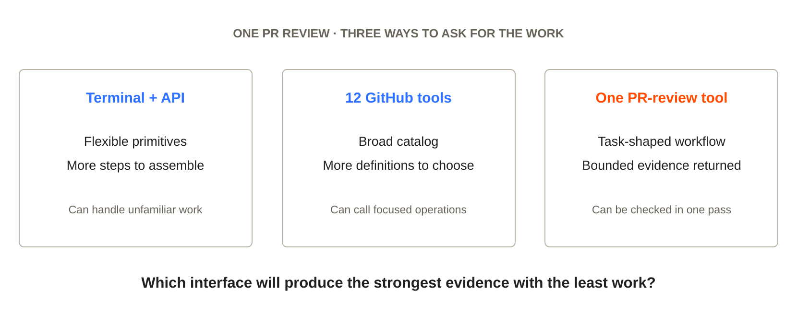

Choose terminal and API access, a broad GitHub tool catalog, or one task-shaped tool.

Defend the tradeoff before we reveal the saved runs.

---
<!-- source-slide: 033 -->
<!-- review-layout: figure-caption -->
## API, MCP, and CLI access

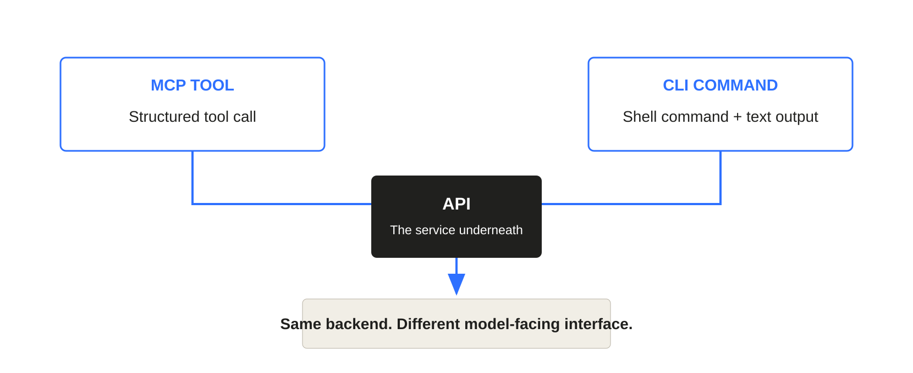

An API defines requests; MCP exposes tools; a CLI exposes commands. Both MCP and CLI can call the same API.

---
<!-- source-slide: 034 -->
<!-- review-layout: figure-caption -->
## PR review across three tool interfaces

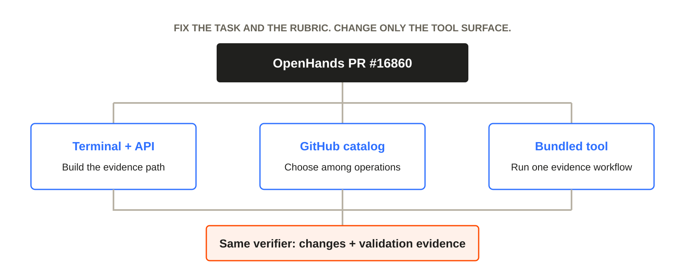

Inspect OpenHands PR #16860 with the same model and rubric. Before the reveal, choose which interface will produce the strongest evidence with the least work.

Source: [Workshop 2 setup and results](../../../harness-benchmark/results/workshop2-tool-surface-preliminary.md)

---
<!-- new-slide: workshop-2-result -->
<!-- review-layout: table -->
## One task-shaped tool beat the terminal and a broad catalog

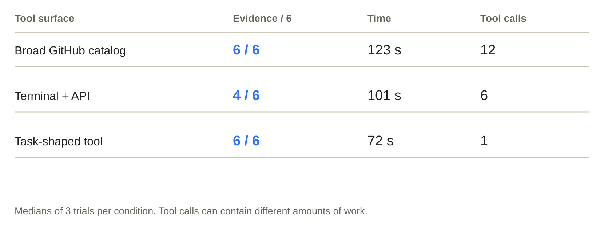

Three-trial medians. The bundled tool encoded a recurring evidence workflow. Lower-level operations still support unfamiliar work.

Source: [Workshop 2 preliminary results](../../../harness-benchmark/results/workshop2-tool-surface-preliminary.md)

---
<!-- new-slide: common-agent-tools -->
<!-- review-layout: table -->
## Common tools in a coding harness

Workshop 2 uses shell and API access, GitHub operations, and one bundled PR-review tool. Real harnesses often expose a broader set.

Source: [fx built-in tools](https://fx.sh/docs/capabilities/tools) · broader categories are common examples, not one product's exact inventory.

---
<!-- new-slide: tools-to-context -->
<!-- review-layout: figure -->
## Tool definitions can fill your context

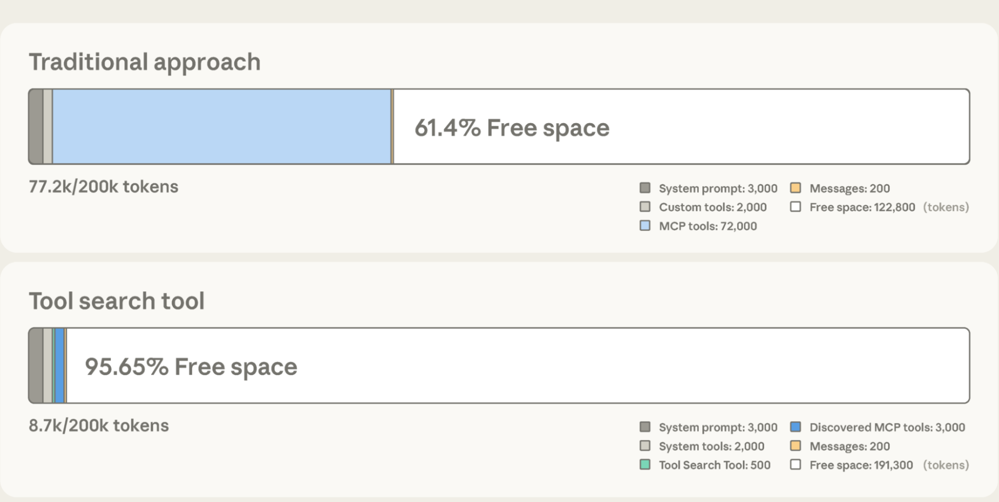

In Anthropic's five-server example, 58 tools used about 55K tokens before the request. Tool search kept common tools visible and deferred the rest. Initial context fell to about 8.7K tokens in the example.

Source: [Anthropic, Advanced tool use](https://www.anthropic.com/engineering/advanced-tool-use)

---
<!-- new-slide: tool-search-method -->
<!-- review-layout: figure-caption -->
## How to use tool search

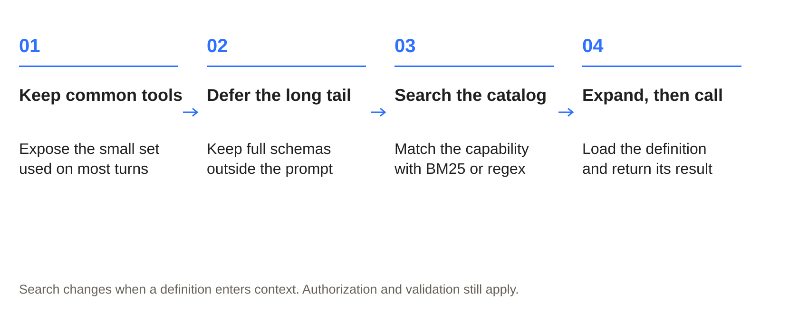

Keep common tools visible. Defer the long tail, search its names and descriptions, then expand the matching definition before the call.

Source: [Anthropic, Advanced tool use](https://www.anthropic.com/engineering/advanced-tool-use)

---
<!-- source-slide: 150 -->
<!-- review-layout: figure -->
## Uber kept 1,000+ MCP tools behind search and the CLI

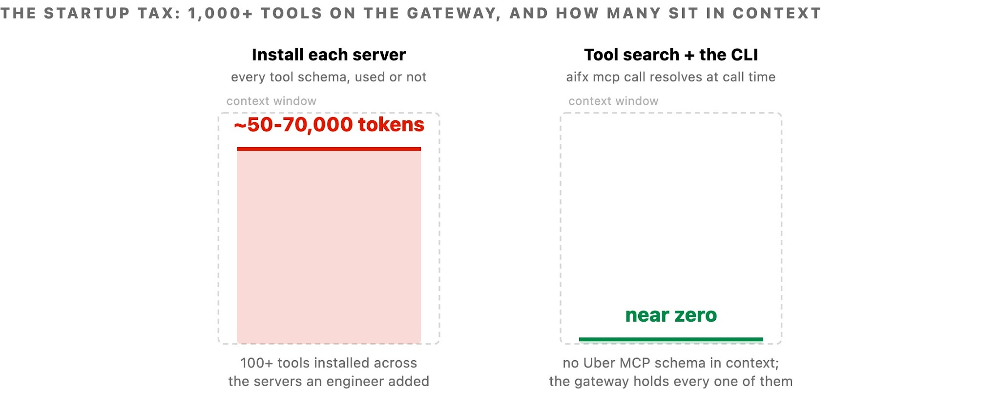

Loading more than 100 MCP schemas cost 50K to 70K tokens. Uber projected the catalog as CLI commands, so the model could search first and resolve a tool only when it needed to call one.

Source: [Uber Engineering, August 27, 2026](https://www.uber.com/ca/en/blog/efficient-software-factory/), Figure 7. Near zero refers to Uber MCP schemas, not all context or discovery overhead.

---
<!-- new-slide: deepseek-runtime-modes -->
<!-- review-layout: table -->
## Harness modes in DeepSeek for tools

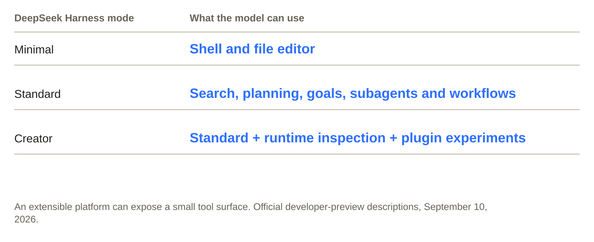

Minimal mode exposes shell and editor tools. Standard adds a broader built-in set. Code exposes tools through a TypeScript SDK. Creator adds runtime and plugin development.

Source: [DeepSeek Harness developer preview](https://www.deepseek.com/harness/en/) · checked September 10, 2026.

---
<!-- source-slide: 038 -->
<!-- review-layout: figure-caption -->
## Cloudflare reduced 2,600 API endpoints to two model-facing tools

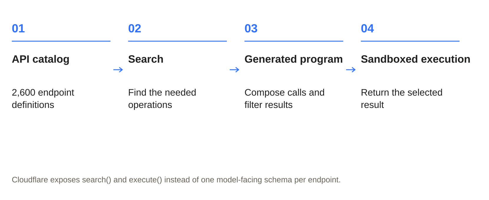

The model sees `search()` and `execute()`. It searches the OpenAPI catalog, writes a short JavaScript program that can make several calls, and runs that program in a sandboxed V8 isolate. Only the selected result returns.

Source: [Cloudflare, Code Mode](https://blog.cloudflare.com/code-mode/)

---
<!-- source-slide: 151 -->
<!-- review-layout: figure-caption -->
## Uber put SQL polling inside a Python loop

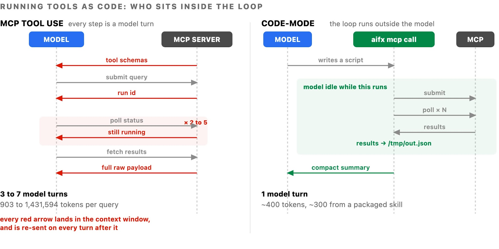

MCP still serves the tools. A Python loop handles query submission, two to five status polls, and result retrieval. Only a compact summary returns to the model.

Source: [Uber Engineering](https://www.uber.com/ca/en/blog/efficient-software-factory/), Figure 8.

---
<!-- new-slide: edit-format -->
<!-- review-layout: table -->
## Three ways an agent can describe the same edit

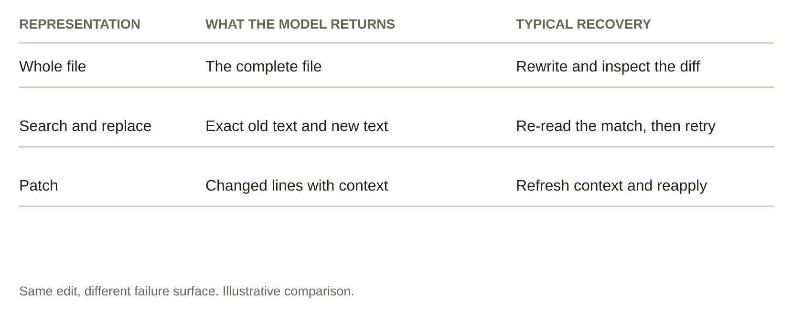

The representation changes how much text the model must reproduce and how the harness recovers from stale context.

---
<!-- source-slide: 036 -->
<!-- review-layout: figure-caption -->
## An unreliable browser created two costs in one run

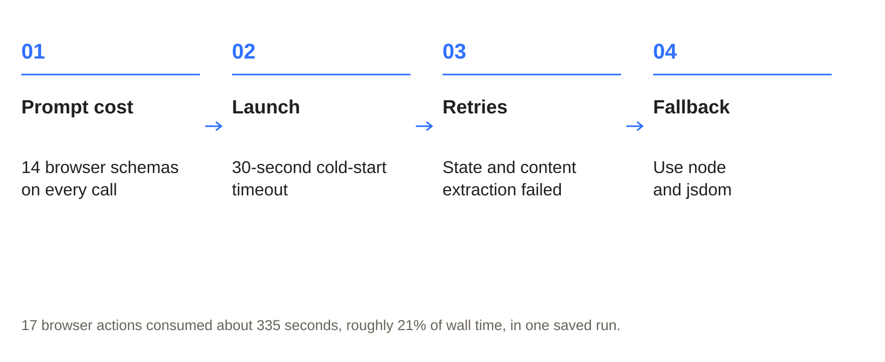

The Incident Operations Center run carried 14 browser schemas on every call. Near the end, 17 browser actions hit a 30-second cold-start timeout and repeated extraction failures before the agent fell back to `node` and `jsdom`.

Source: [Browser tool impact report](../../../harness-benchmark/results/browser-tool-impact.md)

---
<!-- new-slide: tool-evaluation-levels -->
<!-- review-layout: figure -->
## A valid tool call can still leave the task unfinished

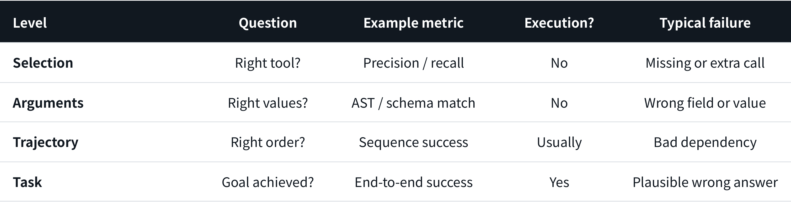

Correct arguments and a successful response do not establish that the returned evidence answers the task.

Source: [CMU 11-768, Lecture 2, page 54](https://www.cmu-agents.com/slides/lecture-02-tool-use.pdf#page=54).

---
<!-- new-slide: workshop-2-debrief -->
<!-- review-layout: figure-caption -->
## The tool surface should match the repeated work

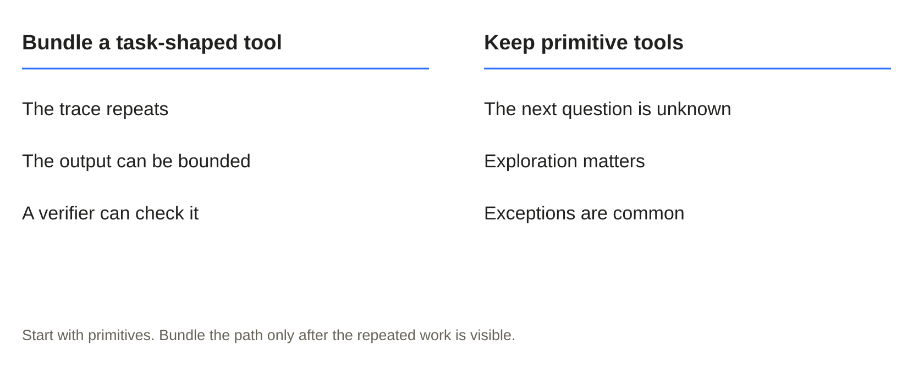

Start with primitives. Bundle the path after the trace repeats, the output can be bounded, and a verifier can check the result.

---
# Workshop 3: Context, working state, and memory

---
<!-- new-slide: workshop-3-section -->
<!-- review-layout: section -->
## Workshop 3: Context, working state, and memory

We will separate what the model sees now from what the system saves for later.

---
<!-- source-slide: 044 -->
<!-- review-layout: figure-caption -->
## What fills the next model call

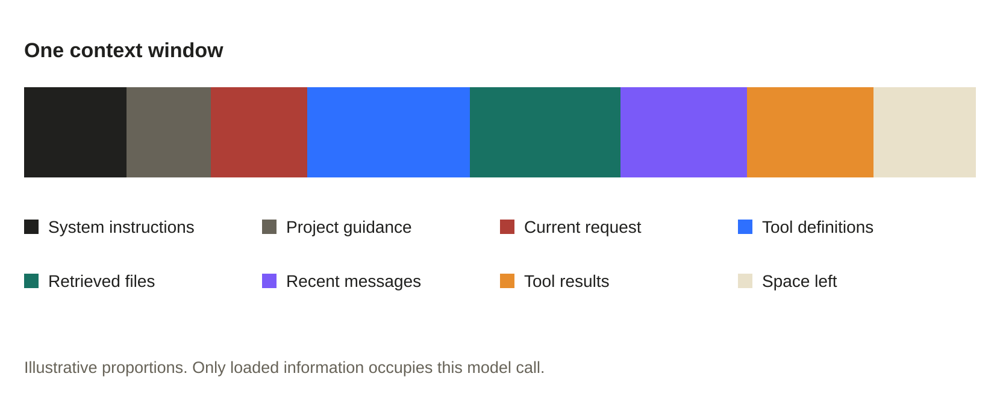

The context window is shared. Instructions, tool definitions, retrieved files, recent messages, and tool results all reduce the space left for the next turn.

---
<!-- source-slide: 042 -->
<!-- review-layout: figure-caption -->
## Context, task state, and reusable guidance serve different timescales

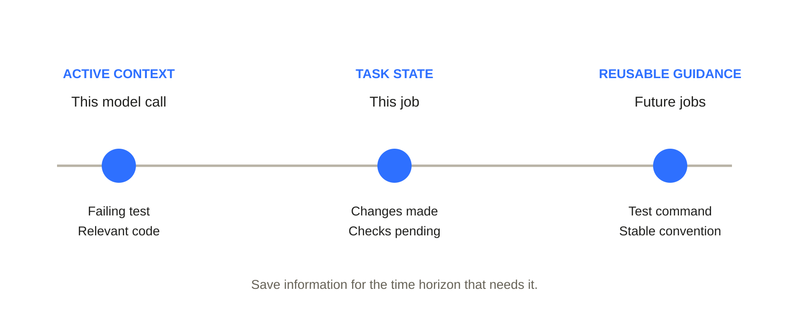

The failing test belongs in this call, unfinished work belongs with the task, and a verified test command can guide future jobs.

---
<!-- source-slide: 041 -->
<!-- review-layout: figure-caption -->
## Apply the distinction: where should the test command live?

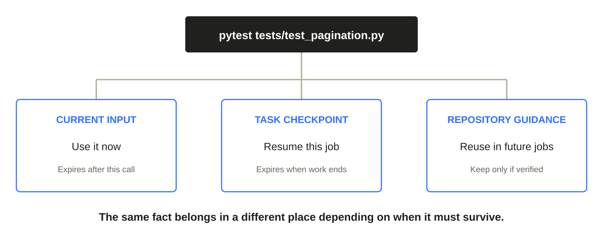

Use the command in current input now, save it in a checkpoint to resume this job, or promote it to repository guidance after it is verified and reusable.

---
<!-- source-slide: 040 -->
<!-- review-layout: figure-caption -->
## Workshop 3: Add cursor pagination

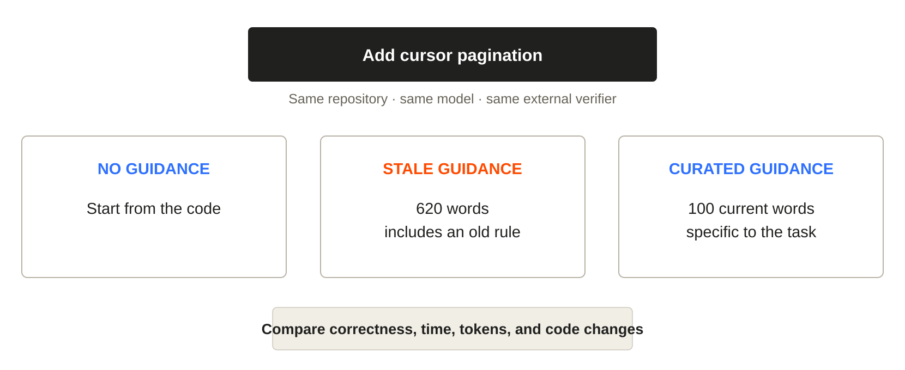

Add cursor pagination without breaking the existing API.

Compare no guidance, 620 words with a stale rule, and 100 words of current guidance. Same repository, model, and external checks.

Source: [Pagination exercise and conditions](../../../harness-benchmark/results/workshop3-context-placement-preliminary.md)

---
<!-- new-slide: workshop-3-prediction -->
<!-- review-layout: figure-caption -->
## Comparing the three context conditions

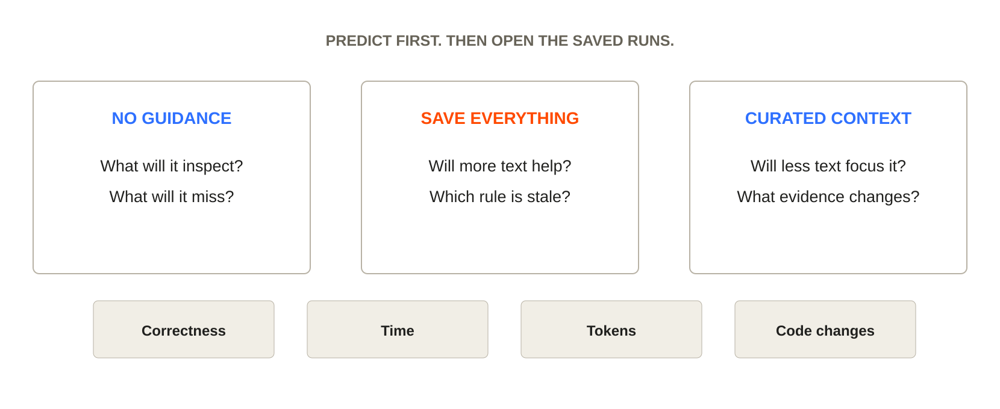

Compare what each condition tells the agent, then check correctness, time, tokens, and code changes.

---
<!-- new-slide: workshop-3-result -->
<!-- review-layout: table -->
## The stale-guidance condition failed all three trials

Three trials per condition. The save-everything guidance deliberately included a stale architecture rule.

Source: [Workshop 3 preliminary results](../../../harness-benchmark/results/workshop3-context-placement-preliminary.md)

---
<!-- new-slide: workshop-3-mechanism -->
<!-- review-layout: figure-caption -->
## All three stale-guidance runs built the wrong module

Each run reported 25 to 32 green tests. The external verifier failed all three because `CursorPage` was absent from `toyapp.pagination`.

Source: [Workshop 3 implementation and verification records](../../../harness-benchmark/results/workshop3-context-placement-preliminary.md)

---
<!-- new-slide: workshop-3-reversal -->
<!-- review-layout: table -->
## Curated context changed the process, not the pass rate

Both conditions passed the external verifier in all three trials. Curated guidance changed verification behavior without reducing processed tokens.

Source: [Workshop 3 preliminary results](../../../harness-benchmark/results/workshop3-context-placement-preliminary.md)

---
<!-- new-slide: measured-persistent-context -->
<!-- review-layout: figure-caption -->
## Providing better context gained 19 points

They identified past failures to generate better prompts and instructions to improve the context.

Source: [Patel et al., What Happens When the Model Eats the Stack?](https://arxiv.org/pdf/2609.03141), Figure 4 and Appendix A.2.

---
<!-- source-slide: 050 -->
<!-- review-layout: figure-caption -->
## What can fill a long context window

Large PDFs, datasets, and repositories can fill even a long context window. Load what the task needs.

---
<!-- source-slide: 051 -->
<!-- review-layout: figure -->
## A long context window does not guarantee useful recall

Fitting the input does not guarantee accurate use of every relevant detail.

Source: [https://claude.com/blog/1m-context-ga](https://claude.com/blog/1m-context-ga)

---
<!-- source-slide: 053 -->
<!-- review-layout: figure -->
## Long conversations can make relevant facts harder to use

Across 15 tested models, performance fell when one fully specified request became a multi-turn, underspecified conversation. Early assumptions made later corrections harder.

Source: [Laban et al., LLMs Get Lost in Multi-Turn Conversation](https://arxiv.org/abs/2505.06120) · [official Microsoft repository](https://github.com/microsoft/lost_in_conversation)

---
<!-- source-slide: 046 -->
<!-- review-layout: figure -->
## Retrieval for the next action

Retrieve the failing test and relevant implementation; include those excerpts in the next model call.

---
<!-- new-slide: retrieval-methods -->
<!-- review-layout: figure-caption -->
## Five ways to retrieve context

Each method chooses evidence differently. Agentic search can use the other four methods as tools, inspect the results, and search again.

Source: [Retrieval-Augmented Generation](https://arxiv.org/abs/2005.11401) · [Microsoft GraphRAG](https://www.microsoft.com/en-us/research/project/graphrag/) · [BRIGHT](https://arxiv.org/abs/2407.12883)

---
<!-- source-slide: 055 -->
<!-- review-layout: figure -->
## A system prompt gives the agent standing instructions

The system prompt shapes behavior across the conversation. Claude Code uses it for tool guidance, safety rules, and information about the working environment.

The user prompt supplies the current task. CLAUDE.md adds guidance about the project.

Source: [Anthropic, Modifying system prompts](https://code.claude.com/docs/en/agent-sdk/modifying-system-prompts) · [prompt-category analysis](../../../experiments/claude-prompt-evolution/README.md)

---
<!-- source-slide: 056 -->
<!-- review-layout: figure-caption -->
## New models can replace old rules with judgment

Anthropic says older models needed the strict rule. Newer models could inspect the surrounding code and make the decision.

Source: [Thariq Shihipar, Anthropic](https://claude.com/blog/the-new-rules-of-context-engineering-for-claude-5-generation-models)

---
<!-- source-slide: 079 -->
<!-- review-layout: figure -->
## Anthropic removed over 80% of Claude Code's system prompt

“We removed over 80% of Claude Code’s system prompt ... with no measurable loss on our coding evaluations.”

Thariq Shihipar, Anthropic. The result covered Opus 5 and Fable 5.

Source: [Anthropic, The new rules of context engineering for Claude 5 generation models](https://claude.com/blog/the-new-rules-of-context-engineering-for-claude-5-generation-models)

---
<!-- source-slide: 059 -->
<!-- review-layout: figure -->
## LangChain cut the base input from 6K to 2K tokens

**System prompt:** removed general guidelines and tool-use prose.

**Tool definitions:** shortened built-in descriptions by 43%.

**Planning middleware:** made the todo prompt and tool optional after evals.

Together, the built-in prompt, tools, and middleware fell about 65%. Conversation history is not included in this number. Overall reward held steady across four tested models.

Source: [LangChain, Deep Agents v0.7](https://www.langchain.com/blog/deep-agents-v0-7)

---
<!-- new-slide: context-budget-stack -->
<!-- review-layout: figure -->
## Workshop result: the same model saw a 4× range in context per call

With GLM-5.2, Pi averaged 6.7K input tokens per call and OpenHands averaged 26.8K. All three harnesses passed 8/8.

Source: [Aug. 24 short-suite results](../../../harness-benchmark/results/short-suite.md). Rounded mean input per call, including repeated context.

---
<!-- source-slide: 063 -->
<!-- review-layout: figure -->
## Five ways to manage a full context window

Continue keeps the history. Rewind returns to an earlier point. Clear starts fresh. Compact replaces older turns with a summary. A subagent moves bounded work into another context.

Source: [Thariq Shihipar, Anthropic](https://x.com/trq212/status/2044548257058328723) · [Claude Code checkpointing](https://code.claude.com/docs/en/agent-sdk/file-checkpointing)

---
<!-- new-slide: summarization -->
<!-- review-layout: figure -->
## Compaction replaces old turns with a continuation summary

The summary keeps the task, completed work, current evidence, and next action. Older tool output leaves the active input but can remain available in the trace. Illustrative pagination example.

---
<!-- new-slide: compaction-preservation-policy -->
<!-- review-layout: figure -->
## What to preserve during compaction

Preserve exact requirements, changed files, verification results, and the next action. Keep bulky evidence retrievable.

Source: Adapted from [CMU 11-768, Lecture 3, page 48](https://www.cmu-agents.com/slides/lecture-03-long-context.pdf#page=48). A design framework, not a measured workshop result. The file path is illustrative. Omitted history is excluded from the next model call, not necessarily deleted from audit storage.

---
<!-- new-slide: repeated-compaction-drift -->
<!-- review-layout: figure -->
## Repeated compaction can weaken an exact requirement

“CUDA 12.4” loses specificity across summaries. Keep exact constraints in a stable record. Illustrative example.

Source: [CMU 11-768, Lecture 3, page 50](https://www.cmu-agents.com/slides/lecture-03-long-context.pdf#page=50). Illustrative, not a measured failure rate.

---
<!-- source-slide: 061 -->
<!-- review-layout: figure -->
## OpenHands reported up to 2× lower per-turn API cost

On a tested SWE-bench Verified subset, the baseline rose above 4¢ per turn while the condenser stayed near 2¢. Average solve rate was 54% with condensation and 53% without it.

Source: [OpenHands, Context Condensation for More Efficient AI Agents](https://www.openhands.dev/blog/openhands-context-condensensation-for-more-efficient-ai-agents)

---
<!-- new-slide: acon-compression -->
<!-- review-layout: figure-caption -->
## ACON used failed runs to improve context compression

Researchers compared failed compressed runs with successful uncompressed runs, then refined the instructions about what to preserve. Across three benchmarks, peak context fell 26–54% and task success improved over other compression baselines.

Source: [Kang et al., ACON, ICML 2026, version 3](https://arxiv.org/abs/2510.00615v3)

---
<!-- new-slide: prompt-caching -->
<!-- review-layout: figure-caption -->
## Claude Code compacts without abandoning the cached prefix

A separate summarization request would miss the cache. Claude Code instead reuses the same system prompt, context, tools, and history, then appends the compaction instruction. Only the final instruction is new.

Source: [Anthropic, prompt caching in Claude Code](https://claude.com/blog/lessons-from-building-claude-code-prompt-caching-is-everything)

---
<!-- source-slide: 064 -->
<!-- review-layout: figure -->
## Resuming a task from saved working state

Save progress and the next action. On resume, verify that the saved state still matches the files.

---
<!-- source-slide: 065 -->
<!-- review-layout: figure -->
## Saving working state in files

A workspace file lets a fresh session resume the plan without replaying the conversation.

---
<!-- source-slide: 068 -->
<!-- review-layout: figure -->
## Using planning to guide ongoing work

A saved task plan records unfinished work across turns. Update it as the work changes.

Source: [https://www.youtube.com/watch?v=geTtqyFnyHA](https://www.youtube.com/watch?v=geTtqyFnyHA)

---
<!-- source-slide: 066 -->
<!-- review-layout: figure -->
## A durable scratchpad predicted success in YC-Bench

Only three of twelve models grew their starting capital. Scratchpad use was the strongest predictor, without proving causation.

Source: [Chen et al., YC-Bench](https://arxiv.org/abs/2604.01212)

---
<!-- source-slide: 043 -->
<!-- review-layout: figure -->
## Saved information must be loaded before the model can use it

Saved information extends context only when the agent retrieves or loads it.

---
<!-- source-slide: 071 -->
<!-- review-layout: figure -->
## A verified task lesson can become future guidance

Move a verified command or stable convention into reusable guidance. Keep the evidence and unfinished work with the current task.

---
<!-- source-slide: 073 -->
<!-- review-layout: figure-caption -->
## AGENTS.md: repository guidance for future tasks

`AGENTS.md` supplies repository guidance: verified test commands, conventions, and architecture requirements. Keep temporary progress in task notes.

Source: [AGENTS.md specification](https://agents.md/)

---
<!-- source-slide: 078 -->
<!-- review-layout: figure-caption -->
## One test-cost warning reduced wasted full-suite runs

The repository warned that its full test suite takes more than 20 minutes. With no guidance, Claude launched the full suite 3.67 times per experimental cell. With selective guidance, that fell to 1.67 and wall-clock time fell from 2,689 to 2,032 seconds. Correctness did not change, and the result was exploratory.

Source: [Khatri, Do Context Files Help Coding Agents?, version 1](https://arxiv.org/abs/2607.27250v1), Table 2

---
<!-- source-slide: 074 -->
<!-- review-layout: figure -->
## The token cost of repository instructions

Repository instructions consume tokens whenever the harness includes them in a model call.

---
<!-- source-slide: 075 -->
<!-- review-layout: figure -->
## Generated AGENTS.md files lowered success and raised cost

Automatically generated guidance increased inference cost by over 20% in the cited study.

Source: [https://arxiv.org/pdf/2602.11988v1](https://arxiv.org/pdf/2602.11988v1)

---
<!-- source-slide: 076 -->
<!-- review-layout: figure-caption -->
## 91 of 100 files had duplicated, oversized, misplaced, stale, or unclear instructions

The audit found repeated lint rules in 62 files. Forty-two files exceeded 200 lines. Thirty-five loaded specialized procedures for every task. Other files had unexplained references, unchanged generated content, or conflicting instructions.

Source: [Santos et al., Configuration Smells in AGENTS.md Files, version 5](https://arxiv.org/abs/2606.15828v5), Table II

---
<!-- source-slide: 077 -->
<!-- review-layout: figure-caption -->
## Pass rates barely changed after adding repository guidance in 288 runs

Researchers compared no guidance, AGENTS.md loaded every turn, and files retrieved only when needed. Claude passed 53.3% to 55.6%. Codex passed 52.9% to 58.8%. The study covered 17 tasks in three Python repositories and could not rule out smaller effects.

Source: [Khatri, Do Context Files Help Coding Agents?, version 1](https://arxiv.org/abs/2607.27250v1), Table 1

---
<!-- source-slide: 081 -->
<!-- review-layout: figure -->
## A skill loads detailed instructions only when the task needs them

The prompt carries a small catalog. The full `SKILL.md`, references, and scripts enter context only after the agent selects that skill.

Source: [Anthropic, Equipping agents for the real world with Agent Skills](https://www.anthropic.com/engineering/equipping-agents-for-the-real-world-with-agent-skills)

---
<!-- source-slide: 082 -->
<!-- review-layout: figure-caption -->
## Curated skills raised average pass rate from 33.9% to 50.5%

The 16.6-point average gain covered 87 tasks and 18 model-harness configurations. Individual configurations gained 4.1 to 25.7 points.

Source: [Li et al., SkillsBench, version 4](https://arxiv.org/abs/2602.12670v4)

---
<!-- source-slide: 084 -->
<!-- review-note: Review source: confirm which tested skills and baseline support this fraction. -->
<!-- review-layout: figure-full -->
## Some skills still reduced performance

Source: [https://www.reddit.com/r/rajistics/comments/1r77v1h/skillsbench_showed_models_arent_good_at/](https://www.reddit.com/r/rajistics/comments/1r77v1h/skillsbench_showed_models_arent_good_at/)

---
<!-- source-slide: 090 -->
<!-- review-layout: figure -->
## Evaluate a skill on the work it should improve

Compare the same work with and without the skill, including correctness, time, and cost.

Source: [Blog post: https://openhands.dev/blog/evaluating-agent-skills Repo: https://github.com/rajshah4/evaluating-skills-tutorial](https://openhands.dev/blog/evaluating-agent-skills); [Blog post: https://openhands.dev/blog/evaluating-agent-skills Repo: https://github.com/rajshah4/evaluating-skills-tutorial](https://github.com/rajshah4/evaluating-skills-tutorial)

---
<!-- new-slide: workshop-3-debrief -->
<!-- review-layout: figure-caption -->
## Where should each lesson go?

Ask the room to choose `AGENTS.md`, skill, task note, or delete for each item. Reveal the destinations after volunteers explain their choices.

---
<!-- source-slide: 095 -->
<!-- review-layout: figure-caption -->
## Only verified, stable, reusable information should survive the task

The destination depends on scope, but every durable item must be supported by evidence, likely to remain true, and useful beyond the current run.

Source: [Workshop 3 preliminary results](../../../harness-benchmark/results/workshop3-context-placement-preliminary.md)

---
# Workshop 4: Model routing

---
<!-- new-slide: workshop-4-section -->
<!-- review-layout: section -->
## Workshop 4: Flexible model choice

The harness can choose by task, delegate to another model, or switch after new evidence.

---
<!-- source-slide: 096 -->
<!-- review-layout: figure-caption -->
## A harness can choose a different model for each task or attempt

Choose the starting model, verification method, and one signal that may change the route. Ask the room to design both paths before revealing the workshop result.

---
<!-- new-slide: routing-benefits -->
<!-- review-layout: figure-caption -->
## Routing lets the harness spend capability where it matters

The benefit is not merely a cheaper model. A policy can reserve stronger capability for costly failures and use verified outcomes to improve later routing decisions.

Source: [Workshop 4 preliminary results](../../../harness-benchmark/results/workshop4-model-routing-preliminary.md) · [Zhou et al., Agent-as-a-Router](https://arxiv.org/abs/2606.22902)

---
<!-- new-slide: workshop-4-repeated-result -->
<!-- review-layout: table -->
## Static routing passed 12/12 at 41.5% lower cost

Four tasks × three trials. Costs are median four-task bills. Strongest-only finished faster.

Source: [September 7 routing experiment](../../../harness-benchmark/results/workshop4-model-routing-preliminary.md). Haiku 4.5, Sonnet 4.6, Opus 4.8, SDK 1.45.0. Selected toy tasks and three trials support a workshop demonstration.

---
<!-- source-slide: 099 -->
<!-- review-layout: figure -->
## A router found a better quality-cost point than one fixed model

The reported router selected among Anthropic models and reasoning levels: 50.7% at $4.28 per attempt on a simulated-user benchmark. This is evidence that the model choice can change with the interaction.

Source: [Not Diamond, September 1, 2026](https://www.notdiamond.ai/blog/interactive-benchmarks-a-new-methodology-for-evaluating-model-routing). Original chart. Preserve the benchmark and cost-per-attempt labels.

---
<!-- source-slide: 109 -->
<!-- review-layout: figure-full -->
## Routing can choose another attempt instead of a stronger model

Two GLM attempts: 57.8% at $7.90. One Sonnet attempt: 52.7% at $25.84. Best-of-two requires a result-selection mechanism.

Source: [Zain Hasan, DeepSWE rollout analysis](https://www.linkedin.com/pulse/glm-52-vs-sonnet-5-comparing-open-closed-software-tasks-zain-hasan-nnlzc). 452 rollouts per model.

---
<!-- source-slide: 111 -->
<!-- review-layout: figure-full -->
## Different models spend the harness budget differently

Tests appeared in 92% versus 82% of runs. Sonnet rollouts cost 6.5 times more. 452 rollouts per model.

Source: [Zain Hasan, DeepSWE rollout analysis](https://www.linkedin.com/pulse/glm-52-vs-sonnet-5-comparing-open-closed-software-tasks-zain-hasan-nnlzc). Bars use separate scales for each reported measure.

---
<!-- source-slide: 106 -->
<!-- review-layout: figure-full -->
## Execution feedback can improve the next routing decision

The researchers’ verifier executed candidate code in a sandbox and stored the result for later routing decisions.

Source: [Zhou et al., Agent-as-a-Router, Figure 2](https://arxiv.org/abs/2606.22902). Original paper figure, cropped for legibility.

---
<!-- source-slide: 107 -->
<!-- review-layout: figure-full -->
## Escalation is useful only when the signal is trustworthy

Static routing passed 12/12 at $0.517 versus $0.628 for the cascade. The cascade lacked an external verifier after each tier.

Source: [Zhou et al., Agent-as-a-Router, Table 1](https://arxiv.org/abs/2606.22902) · [September 7 routing experiment](../../../harness-benchmark/results/workshop4-model-routing-preliminary.md)

---
<!-- new-slide: routing-cache -->
<!-- review-layout: figure-full -->
## Switching models can trade away cache reuse

Anthropic caches are model-specific. Switching can require reprocessing history. Include that cost in the routing decision.

Source: [Anthropic, prompt caching in Claude Code](https://claude.com/blog/lessons-from-building-claude-code-prompt-caching-is-everything)

---
<!-- new-slide: workshop-4-debrief -->
<!-- review-layout: figure-full -->
## Which evidence would make you change the model?

Choose a starting model, a verifier, and one escalation signal. Count repeated input, cache loss, verification, and latency before deciding that a switch helped.

---
# Workshop 5: Goals, validation, and stopping

---
<!-- new-slide: workshop-5-section -->
<!-- review-layout: section -->
## Workshop 5: Goals, validation, and stopping

I missed Claude Code's `/loop` until Codex Goals made the pattern click: keep the objective active, return to the work, and check whether it is done.

Source: [Claude Code `/loop`](https://code.claude.com/docs/en/scheduled-tasks) · [Codex `/goal`](https://learn.chatgpt.com/use-cases/follow-goals)

---
<!-- new-slide: goal-validation-loop -->
<!-- review-layout: table -->
## A useful goal loop records six things

The outcome stays stable. State and evidence change after each bounded attempt.

---
<!-- source-slide: 140 -->
<!-- review-layout: figure -->
## AutoResearch keeps a change only when the metric improves

Each attempt has a fixed budget. Keep the commit when the metric improves, otherwise reset. Record the result and stop when the stated criterion is met.

Source: [Karpathy, AutoResearch](https://github.com/karpathy/autoresearch)

---
<!-- source-slide: 115 -->
<!-- review-layout: figure -->
## Does this request need a code change?

Fix `slugify` in two repository variants. One is already correct. Inspect before editing.

---
<!-- new-slide: acceptance-check-contract -->
<!-- review-layout: figure -->
## Define done before the agent starts editing

Name the outcome, check, evidence, and allowed terminal states. Then compare every attempt against the same contract.

---
<!-- new-slide: workshop-5-ceiling -->
<!-- review-layout: table -->
## Validation added cost when the first result already passed 8/8

The completion system found nothing to repair. Time rose 21% and provider tokens rose 67%.

Source: [Completion-loop campaign](../../../harness-benchmark/results/completion-loop-sonnet46.md). One campaign per condition, Sonnet 4.6. Provider tokens include cached input.

---
<!-- new-slide: workshop-5-repair-cost -->
<!-- review-layout: table -->
## Validation found two repairs, but Pi still stopped at 6/9

Two repair rounds recovered two requirements. Three stayed unmet when the budget ended.

Source: [Corrected freight results](../../../harness-benchmark/results/freight-control-tower-sonnet46.md). Separate exploratory trajectories, not matched-budget trials.

---
<!-- new-slide: verifier-next-action -->
<!-- review-layout: figure -->
## Validation decides whether to finish, repair, escalate, or stop

A pass supports completion. A useful failure supports a repair. A budget limit supports an honest incomplete result.

---
<!-- source-slide: 123 -->
<!-- review-layout: figure -->
## One request can contain hundreds of progress decisions

The harness repeats the loop until the goal passes, work is blocked, or a limit ends the run.

Source: [OpenAI, Unrolling the Codex agent loop](https://openai.com/index/unrolling-the-codex-agent-loop/)

---
<!-- new-slide: armin-factory -->
<!-- review-layout: table -->
## GPT-6 Astra showed that a software factory can run without making progress

A broad goal kept the factory running for 35 hours. It lacked checks for readable, maintainable code and a rule for when to stop.

Source: [Armin Ronacher, Astra for Coding: Why Are We Doing This Again?](https://lucumr.pocoo.org/2026/9/7/astra-why/)

---
<!-- new-slide: goal-quality-kill-switch -->
<!-- review-layout: figure -->
## A goal needs quality checks and a kill switch

Hours, tokens, commits, and lines show activity. Continue only when behavior and code quality still justify another bounded attempt.

Source: [Armin Ronacher](https://lucumr.pocoo.org/2026/9/7/astra-why/) · [Prime Agent long-running design](https://github.com/PrimeIntellect-ai/prime-agent/blob/main/packages/coding-agent/docs/long-running-agents.md)

---
<!-- source-slide: 067 -->
<!-- review-layout: figure -->
## Long runs can lose the goal even when each step is simple

In Vending-Bench, activity declined and every model eventually stopped selling. A longer run needs durable progress state.

Source: [Petersson and Jakkala, Vending-Bench](https://lukaspetersson.com/assets/pdf/vbench_paper.pdf)

---
<!-- source-slide: 118 -->
<!-- review-layout: figure -->
## Durable goal workflows survive interruptions and restore state

Persist the goal, progress, latest evidence, and next action. After a restart, verify the workspace before continuing.

---
<!-- source-slide: 135 -->
<!-- review-layout: figure -->
## An evidence gate blocks completion until the required proof passes

An evidence gate is an executable stop rule: no completion claim is accepted without current, in-scope evidence for every required outcome.

In 66 incomplete checkpoints, the paper's gate reduced unsupported stops from 40 to 0. It verifies trace support, not external truth or overall code quality.

Source: [Jason Liu, Evidence-Carrying Termination, Figure 1](https://arxiv.org/abs/2608.23623)

---
<!-- source-slide: 142 -->
<!-- review-layout: figure-full -->
## Define the validation contract before the agent writes code

Source: [Luke Alvoeiro, Factory, The Multi-Agent Architecture That Actually Ships, 6:34](https://www.youtube.com/watch?v=ow1we5PzK-o&t=394s)

---
<!-- new-slide: fresh-evidence -->
<!-- review-layout: figure -->
## Fresh evidence gates completion

A hook runs the required check after the latest edit. The harness accepts completion only from the current result.

Source: Design synthesis from [Evidence-Carrying Termination](https://arxiv.org/abs/2608.23623) and [OpenAI, Harness engineering](https://openai.com/index/harness-engineering/)

---
<!-- source-slide: 134 -->
<!-- review-layout: figure -->
## A failed check should change the next attempt

The validator identifies the failed requirement. The harness uses that evidence to form a new hypothesis, choose a different action, or escalate.

Source: [Factory validation loop](https://ai.engineer/talks/ow1we5PzK-o-production-multi-agent-architecture)

---
<!-- new-slide: validation-ladder -->
<!-- review-layout: figure -->
## A passing test is not enough to ship code

Executable repository rules catch structural failures. Human review protects qualities that remain difficult to encode.

Source: [Armin Ronacher](https://lucumr.pocoo.org/2026/9/7/astra-why/) · [OpenAI, Harness engineering](https://openai.com/index/harness-engineering/)

---
<!-- new-slide: workshop-5-debrief -->
<!-- review-layout: figure -->
## The evidence and remaining budget determine the next move

Ask a volunteer to choose a branch. Another attempt is justified only by a new hypothesis and enough budget to test it.

Source: Workshop synthesis from the preceding evidence, not a published result.

---
# Workshop 6: Multi-agent systems

---
<!-- new-slide: workshop-6-section -->
<!-- review-layout: section -->
## Workshop 6: Multi-agent systems

Should another agent own part of this work?

---
<!-- source-slide: 154 -->
<!-- review-layout: table -->
## Another agent adds capacity and a coordination bill

Parallel work can finish sooner. The parent still pays to assign the work, pass context, combine the results, and verify the whole.

---
<!-- source-slide: 160 -->
<!-- review-layout: text -->
## Where have multiple agents helped or hurt your coding work?

---
<!-- source-slide: 155 -->
<!-- review-layout: text -->
## Which task would you delegate?

**A. Pagination repair:** workers would edit the same code.

**B. Five repository investigations:** each worker can inspect a separate repository.

Vote for one agent, a worker plus validator, or parallel investigators.

Keep the total budget the same.

---
<!-- source-slide: 157 -->
<!-- review-layout: figure -->
## Parallelize independent investigations; keep shared edits with one owner

The split works when each result can be checked independently. Shared changing files create conflicts and serial dependencies.

Sources: [Anthropic](https://www.anthropic.com/engineering/multi-agent-research-system) · [LangChain](https://www.langchain.com/blog/how-and-when-to-build-multi-agent-systems) · [Cognition](https://cognition.com/blog/dont-build-multi-agents)

---
<!-- source-slide: 167 -->
<!-- review-layout: figure-caption -->
## Parallel research improved 90.2% when the searches were independent

Anthropic compared an Opus 4 lead with Sonnet 4 workers against one Opus 4 agent on an internal research evaluation. The compute was unequal. Its separate 15× token figure compares multi-agent research with chat, not with the single-agent research baseline.

Source: [Anthropic, multi-agent research system](https://www.anthropic.com/engineering/multi-agent-research-system)

---
<!-- source-slide: 162 -->
<!-- review-layout: figure-caption -->
## Splitting a large tool catalog helped smaller models but hurt GPT-5

In Snorkel's All Tools condition, multi-agent accuracy rose 3.8 points for GPT-5 Nano and 20.3 points for GPT-5 Mini, then fell 7.6 points for GPT-5. The experiment used a limited sample and retained API-error-free runs.

Source: [Snorkel, enterprise tool-use experiment](https://snorkel.ai/blog/multi-agents-in-the-context-of-enterprise-tool-use/)

---
<!-- source-slide: 169 -->
<!-- review-layout: figure-caption -->
## With an equal reasoning budget, one agent usually matched or beat the group

At the requested 500-token budget, a single-agent variant was best or statistically tied in six of eight model and dataset comparisons. Gemini did not always use the requested number of reasoning tokens, so the authors also report realized usage.

Source: [Tran and Kiela, arXiv 2604.02460, Table 1](https://arxiv.org/abs/2604.02460)

---
<!-- source-slide: 172 -->
<!-- review-layout: figure -->
## Every tested multi-agent architecture made SWE-bench results worse

Across eight models, all four multi-agent architectures scored below the single-agent baseline: from −1.3% for hybrid to −12.8% for independent. Each configuration used 20 SWE-bench Verified tasks, so the exact per-cell gaps are imprecise.

Source: [Kim et al., Nature Machine Intelligence, 2026](https://www.nature.com/articles/s42256-026-01268-y)

---
<!-- source-slide: 170 -->
<!-- review-layout: figure-caption -->
## Shared code became harder to merge as more agents joined

In Anthropic's 12-hour shared-repository experiment, earlier Claude models opened many conflicting pull requests and merged fewer as the group grew. Newer models often avoided conflicts by keeping stronger file ownership.

Source: [Anthropic, Patterns and problems in emerging multiagent systems](https://www.anthropic.com/research/multiagent-systems)

---
<!-- source-slide: 171 -->
<!-- review-layout: figure-caption -->
## Factory serializes code changes and parallelizes read-only work

Factory reports using one code-changing worker or validator at a time. Code search, API research, and independent review can still run in parallel because they do not compete to modify the same state.

Source: [Luke Alvoeiro, The Multi-Agent Architecture That Actually Ships](https://ai.engineer/talks/ow1we5PzK-o-production-multi-agent-architecture)

---
<!-- source-slide: 175 -->
<!-- review-layout: figure -->
## Design the handoff around three failure surfaces

Across 1,642 traces from seven systems, MAST grouped 14 failure modes into system design, inter-agent misalignment, and task verification. A delegation contract should defend all three.

Source: [Cemri et al., MAST, NeurIPS 2025](https://arxiv.org/abs/2503.13657)

---
# Close

---
<!-- new-slide: closing-six-decisions -->
<!-- review-layout: table -->
## Six decisions shape how the agent works

The model chooses actions inside the environment created by these harness decisions.

---
<!-- source-slide: 020 -->
<!-- review-layout: figure -->
## Two harness settings raised ARC-AGI-3 from 13.3% to 38.3%

The model stayed fixed. Retaining reasoning and replacing rolling truncation with compaction tripled the reported RHAE score and used six times fewer output tokens.

Source: [OpenAI, How enabling two settings tripled our scores](https://openai.com/index/how-two-settings-tripled-our-arc-agi-3-scores/)

---
<!-- source-slide: 177 -->
<!-- review-layout: table -->
## A learned harness raised Opus 4.6 from 74.7% to 76.4%

Meta-Harness generated and selected agent configurations for TerminalBench 2.0 instead of relying on one fixed, hand-written setup.

Source: [Meta-Harness](https://yoonholee.com/meta-harness/)

---
<!-- source-slide: 179 -->
<!-- review-layout: table -->
## Harness-R1 gained 9.3 points while the task model stayed frozen

A separate 9B harness engineer converted batches of failures into validated runtime patches for a frozen Qwen3.5-9B task model.

Source: [arxiv.org](https://arxiv.org/abs/2608.02276)

---
<!-- source-slide: 027 -->
<!-- review-layout: figure-full -->
## The harness and runtime accumulate technical debt around the model

Source: [Han Lee, Hidden Technical Debt of AI Systems: Agent Runtime](https://leehanchung.github.io/blogs/2026/04/24/hidden-technical-debt-agent-runtime/)

---
<!-- source-slide: 028 -->
<!-- review-layout: figure -->
## OpenHands and OpenCode each merged about 5,700 PRs in one year

Production harnesses require ongoing engineering as models, tools, providers, and workloads change.

Source: [Repository activity analysis](../../../experiments/maintenance/blog-fork-vs-maintain.md)

---
<!-- source-slide: 103 -->
<!-- review-layout: text -->
## Model changes can make harness workarounds obsolete

A workaround that helps one model can hinder the next. Preserve stable repository facts, but retest model-specific prompts, tools, and routing rules after a model change.

Source: [developers.openai.com](https://developers.openai.com/api/docs/guides/latest-model?model=gpt-5.5)

---
<!-- new-slide: closing-next-change -->
<!-- review-layout: figure -->
## One harness change, measured against the baseline

Choose one observed failure. Change one harness decision, repeat the task, and use the same acceptance checks to decide whether to keep it.

Workshop: [github.com/rajshah4/harness-engineering](https://github.com/rajshah4/harness-engineering)

---
# Reserves

Supporting evidence and alternate routes. These slides remain available but sit outside the main workshop line.

---
<!-- new-slide: safety-section -->
<!-- review-layout: section -->
## Safety: control what can change the harness

Tools and other agents can suggest changes. Trusted policy decides what may execute and what may persist.

---
<!-- new-slide: memory-writers -->
<!-- review-layout: figure -->
## Retrieved content should not rewrite future instructions

Tool output and retrieved text remain untrusted. A reviewed source and scope are required before anything becomes durable guidance.

---
<!-- source-slide: 146 -->
<!-- review-layout: figure -->
## Permissions should match the consequence of the action

Reading a file and publishing a change need different permission controls.

Source: [Anthropic, permission controls](https://www.anthropic.com/engineering/beyond-permission-prompts-making-claude-code-more-secure-and-autonomous)

---
<!-- source-slide: 153 -->
<!-- review-layout: figure -->
## Validation helped one workshop task and not the other

Incident stayed at 8/8 with more work. Freight Pi rose from 4/9 to 6/9, also with much more work.

---
<!-- source-slide: 136 -->
<!-- review-layout: figure -->
## A retry needs a new hypothesis or a different action

Repeating the same action against the same state is not progress. Use the failure to change the edit, evidence, model, or escalation path.

---
<!-- new-slide: hooks -->
<!-- review-layout: figure -->
## Hooks can enforce checks outside the prompt

A stop hook can reject completion when fresh evidence is missing. The rule runs in code, even if the model forgets the instruction.

---
<!-- source-slide: 143 -->
<!-- review-layout: figure -->
## Make stable repository requirements executable

Use lint, dependency, API, and architecture checks. Return a failure that points to the requirement and a repair path.

Source: [OpenAI, Harness engineering](https://openai.com/index/harness-engineering/)

---
<!-- source-slide: 137 -->
<!-- review-layout: figure -->
## Repeated attempts supported a large codebase port

The reported 600,000-line port used repeated attempts over four days. Ask what changed and how the final result was checked.

Source: [Ronin Consulting, Using the Ralph Wiggum loop](https://www.ronin.consulting/artificial-intelligence/using-the-ralph-wiggum-loop/)

---
<!-- source-slide: 125 -->
<!-- review-layout: figure -->
## Fewer instructions can leave more room to inspect evidence

Fewer prescribed steps may leave room to inspect the environment before choosing an approach.

Source: [The Danger of Overthinking](https://arxiv.org/abs/2603.09004)

---
<!-- source-slide: 108 -->
<!-- review-layout: text -->
## The inference provider is part of the configuration

Record provider and model settings when comparing results.

Source: [Yun Jin, Same weights, different model](https://www.linkedin.com/pulse/same-weights-model-yun-jin-ch8bc)

---
<!-- source-slide: 102 -->
<!-- review-layout: text -->
## Shared repository instructions across tools

Maintain shared repository facts once; use supported imports or wrappers for each tool’s loading rules.

Source: [x.com](https://x.com/trq212/status/2092302273099796842)

---
<!-- source-slide: 047 -->
<!-- review-layout: text -->
## Choosing what belongs in the next model input

Load the current goal and relevant evidence; keep unrelated history available for retrieval.

---
<!-- source-slide: 060 -->
<!-- review-layout: text -->
## Resetting context and compacting history

Reset: reload the task into a fresh context.

Compaction: replace older conversation with a summary.

Both need an explicit rule for what survives.

---
<!-- source-slide: 188 -->
<!-- review-layout: figure -->
## BM25 retrieves exact and unusually specific terms

Lexical ranking is a strong starting point for symbols, error messages, and other precise queries.

---
<!-- source-slide: 189 -->
<!-- review-layout: figure -->
## Embeddings retrieve passages with similar meaning

Semantic retrieval can find relevant text even when the query and source use different words.

---
<!-- new-slide: retrieval-augmented-generation -->
<!-- review-layout: text -->
## RAG loads selected evidence before generation

A query searches an index, the harness ranks the results, and a bounded set enters the next model call.

Retrieval quality still determines which evidence the model can use.

---
<!-- new-slide: graph-retrieval -->
<!-- review-layout: text -->
## Graph retrieval follows relationships across the codebase

Text search finds matching passages. A code graph can follow definitions, calls, imports, and dependencies across files.

Add that structure when relationships close a measured retrieval gap.

---
<!-- source-slide: 192 -->
<!-- review-layout: figure -->
## GPT-4 query expansion made BM25 strongest on BRIGHT

An LLM can turn reasoning steps into new lexical queries. On this benchmark, BM25 with GPT-4 queries outperformed the tested one-shot retrievers.

Source: [BRIGHT](https://arxiv.org/abs/2407.12883)

---
<!-- source-slide: 030 -->
<!-- review-layout: text -->
## What a tool exposes to the model

A PR tool can return one file, one patch, or the full review evidence. That changes the model's retrieval work.

---
<!-- source-slide: 032 -->
<!-- review-layout: figure -->
## Tool search keeps unused definitions out of the prompt

Search makes relevant tools available without loading every definition into the initial prompt.

---
<!-- source-slide: 196 -->
<!-- review-layout: text -->
## Initial context use with deferred tool loading

Initial tool context fell from about 77K to 8.7K tokens in the five-server example. Tool discovery still adds overhead.

---
<!-- source-slide: 098 -->
<!-- review-layout: text -->
## Routing choices for two tasks

Pagination: escalate after a failed verifier?

Authentication: start stronger or require independent review?

One escalation allowed. Name the trigger.

---
<!-- source-slide: 100 -->
<!-- review-layout: figure -->
## Quality and cost in model routing

Choose models for the required quality and total cost, including retries and verification.

---
<!-- source-slide: 112 -->
<!-- review-layout: text -->
## A routing policy for one task

Specify a starting model, escalation signal, verification, and total budget. Find the corresponding decision point in a saved trace.

---
<!-- source-slide: 113 -->
<!-- review-layout: text -->
## Completion and elapsed time in two model runs

Sonnet: 7/8 in 12.4 minutes. GLM: 8/8 in 26.7 minutes. Separate trajectories, not an isolated routing comparison.

---
<!-- source-slide: 114 -->
<!-- review-layout: text -->
## Verification feeds the next decision

Verification supplies the feedback needed to retry, switch models, or stop.

---
<!-- source-slide: 117 -->
<!-- review-layout: figure -->
## Budgets and stopping conditions

Define completion, retry limits, and terminal states outside the model’s own completion claim.

---
<!-- source-slide: 127 -->
<!-- review-layout: text -->
## Saving progress during long tasks

Checkpoints preserve progress when a long task stops or fails.

Source: [addyo.substack.com](https://addyo.substack.com/p/long-running-agents)

---
<!-- source-slide: 129 -->
<!-- review-layout: text -->
## Completion criteria and external checks

External checks define completion; budgets and blockers define when unfinished work must stop.

Source: [addyo.substack.com](https://addyo.substack.com/p/practical-loop-engineering)

---
<!-- source-slide: 133 -->
<!-- review-note: Review source: confirm the reported 90.3% result and evaluation setting. -->
<!-- review-layout: text -->
## Factory separated implementation from completion control

A separate validator controlled completion: 90.3% reported behavioral parity. The system had a different compute budget from the baseline.

---
<!-- source-slide: 147 -->
<!-- review-note: Review source: these examples come from social reports, not controlled studies. -->
<!-- review-layout: text -->
## Evaluation leakage and changes in refusal behavior

Social reports describe agents accessing evaluation answers or changing refusals across harnesses. These are reported examples, not controlled comparisons.

Source: [x.com](https://x.com/ErikSchluntz/status/2030042086679220676); [x.com](https://x.com/fireworksai_hq/status/2084374420295209209)

---
<!-- source-slide: 152 -->
<!-- review-layout: text -->
## The continuation after a failed check

Record the failed requirement, proposed repair, and remaining budget. After repair, rerun the check; report unresolved failures when stopping.

---
<!-- source-slide: 156 -->
<!-- review-layout: text -->
## Single agent, validator, or parallel workers

One agent, an independent validator, or parallel investigators. Compare all of them within the same total budget.

---
<!-- source-slide: 158 -->
<!-- review-layout: figure -->
## Parallel agents add context and coordination at the same time

Separate context windows enable independent investigations; passing information and combining results consume time and tokens.

---
<!-- source-slide: 176 -->
<!-- review-layout: text -->
## Pi recovered omissions, then tied the best single-agent score

Pi rose from 4/9 to 6/9. Completion systems used roughly 21–22M provider tokens and tied OpenHands’ single-agent score.

Source: [Corrected freight campaign](../../../harness-benchmark/results/freight-control-tower-sonnet46.md)

---
<!-- source-slide: 174 -->
<!-- review-layout: text -->
## Conditions for dynamic workflows

Dynamic workflows need separable tasks, clear ownership, verification, and explicit budgets.

---
<!-- source-slide: 178 -->
<!-- review-layout: figure -->
## Updating a harness from previous runs

Use previous failures to revise the harness, then validate the update before accepting it.

---
<!-- new-slide: harness-update-regression -->
<!-- review-layout: text -->
## Harness updates need to preserve behavior that already worked

Test updated prompts, memory, and skills on earlier tasks as well as new ones. Keep a version you can restore.

Source: [Prime Agent](https://arxiv.org/abs/2608.23552) · [Harness Continual Learning](https://arxiv.org/abs/2608.19013) · [September 7 source notes](../coding-agent-trends-2026.md)

---
<!-- source-slide: 011 -->
<!-- review-layout: text -->
## Why look beyond a provider's default harness?

Existing defaults can miss requirements or repeat work. Harness engineering lets you change the specific behavior behind those failures.

---
<!-- source-slide: 014 -->
<!-- review-layout: text -->
## What to inspect in the saved runs

Find the first useful evidence, compare model calls, and inspect the final verifier result.

---
<!-- new-slide: workshop-1-debrief -->
<!-- review-layout: text -->
## What we learned from the first comparison

Similar completion scores hid different paths, costs, and missed requirements.

The comparison becomes useful when the model, task, environment, and verifier remain fixed.

---
<!-- new-slide: model-harness-coadaptation -->
<!-- review-layout: figure -->
## Applied Compute trained a model to use indexed code search

Applied Compute trained Qwen3.6-35B-A3B with filesystem tools and an indexed search tool.

The indexed-search agent used fewer grep calls and spent more of its work reading retrieved code.

Source: [Applied Compute, Training a Specialist Code Search Agent with turbopuffer](https://www.appliedcompute.com/case-studies/turbopuffer)

---
<!-- source-slide: 197 -->
<!-- review-note: Review relevance: retain the data if you want to discuss variation in measured results. -->
<!-- review-layout: text -->
## Repeated runs changed about 9% of the outcomes

The study held localization fixed and varied code representation. Source code answered 27 of 45 questions, compared with four for summaries.

The working notes report 19K versus 94K context tokens per resolved issue for compressed context and whole files.

About 9% of instance outcomes changed across repeated temperature-zero runs. That variation complicates interpretation of small benchmark differences.

Source: [arxiv.org](https://arxiv.org/abs/2607.09691)

<!-- new-slide: workshop-2-prediction -->
<!-- review-layout: text -->
## Which interface would you expose for this PR review?

Broad catalog: individual GitHub operations.

Terminal/API: construct requests and commands.

Bundled tool: retrieve the recurring evidence in one call.

---
<!-- source-slide: 035 -->
<!-- review-layout: text -->
## Two saved runs took different paths to the same evidence

Broad catalog, trial 1: 15 retrieval calls.

Bundled tool, trial 1: one `get_pull_request_evidence_bundle` call.

Individual traces; the result table reports three-trial medians.

Source: [Trace excerpts and event IDs](review-additions/september-11-pr-traces.md)

---
<!-- new-slide: workshop-2-mechanism -->
<!-- review-layout: text -->
## One bundled tool handles the repeated retrieval steps

One call gathers PR metadata, files, patches, and validation evidence. API work still happens inside the tool.

Source: [Workshop 2 methods](../../../harness-benchmark/results/workshop2-tool-surface-preliminary.md)

---
<!-- new-slide: workshop-2-reversal -->
<!-- review-layout: figure -->
## Reusable tools for recurring investigations

Bundle predictable, recurring retrieval. Keep individual operations available for unfamiliar investigations.

Source: [Workshop 2 preliminary results](../../../harness-benchmark/results/workshop2-tool-surface-preliminary.md)

---
<!-- source-slide: 031 -->
<!-- review-layout: text -->
## From large tool catalogs to tool discovery

Larger catalogs need discovery: load relevant definitions when needed instead of including every tool in every prompt.

---
<!-- source-slide: 205 -->
<!-- review-layout: text -->
## Costs differed by 139 times across complete configurations

One 27B model completed the task under every configuration, with a 139-fold cost spread. The comparison does not isolate the cause.

Source: [Alier Forment et al., controlled MCP/CLI comparison](https://arxiv.org/abs/2608.08654)

---
<!-- new-slide: context-state-hierarchy -->
<!-- review-layout: figure -->
## Prime Agent's approach to storing context and state

Store working state outside the prompt; load selected information into the next call.

Source: [YC Harness Night, 21:17](https://www.youtube.com/watch?v=n9xKblqyQ28&t=1277s), [Prime Agent paper](https://arxiv.org/abs/2608.23552). Screenshot from the source presentation.

---
<!-- new-slide: untrusted-tool-results -->
<!-- review-note: Suggested cut: your existing comment requests removing this topic; retained for your decision. -->
<!-- review-layout: figure -->
## Handling instructions inside tool results

Tool results may contain outside instructions. Validate actions against the user’s request before executing them.

---
<!-- new-slide: memory-social-scope -->
<!-- review-note: Suggested cut: your existing comment requests removing this topic; retained for your decision. -->
<!-- review-layout: figure -->
## Who can access shared memory

Memory for an individual and memory for a shared room need different access rules.

Source: [QM architecture](https://github.com/yc-software/qm), [YC Harness Night, 58:18](https://www.youtube.com/watch?v=n9xKblqyQ28&t=3498s).

---
<!-- new-slide: state-independent-compute -->
<!-- review-layout: figure -->
## Durable state and replaceable execution environments

QM keeps durable state separate from the execution sandbox, so work can resume on different compute.

Source: [QM architecture](https://github.com/yc-software/qm), [YC Harness Night, 51:04](https://www.youtube.com/watch?v=n9xKblqyQ28&t=3064s).

---
<!-- new-slide: openjarvis-system-search -->
<!-- review-layout: figure -->
## System components in OpenJarvis

OpenJarvis exposes the model, inference engine, tools, memory, and learning as separate optimization choices.

Source: [OpenJarvis paper](https://arxiv.org/abs/2605.17172), [YC Harness Night, 37:30](https://www.youtube.com/watch?v=n9xKblqyQ28&t=2250s). Reserve example. Before adding performance figures, retain the benchmark mix, hardware, and marginal-cost definition.

---
<!-- source-slide: 072 -->
<!-- review-layout: figure-full -->
## Saving memory across tasks

---
<!-- source-slide: 002 -->
<!-- review-note: Suggested cut: Duplicate title slide, already in reserves. -->
<!-- review-layout: figure-full -->
## Engineering the Harness: A Practical Workshop

Source: [Rajiv Shah @rajistics OpenHands https://github.com/rajshah4/harness-engineering](https://github.com/rajshah4/harness-engineering)

---
<!-- source-slide: 007 -->
<!-- review-note: Suggested cut: Duplicate harness definition, already in reserves. -->
<!-- review-layout: figure-full -->
## Components outside the model

Source: [https://blog.langchain.com/the-anatomy-of-an-agent-harness/](https://blog.langchain.com/the-anatomy-of-an-agent-harness/)

---
<!-- source-slide: 021 -->
<!-- review-layout: figure -->
## NVIDIA AVO: a kernel-optimization workflow

CUDA knowledge, experiment history, and correctness/throughput checks support the kernel search; a supervisor intervenes when it stalls.

---
<!-- source-slide: 037 -->
<!-- review-layout: figure -->
## Retrieval tools

Embeddings retrieve by meaning; BM25 by keywords. Agentic search uses model decisions to refine retrieval.

Source: [www.uber.com](https://www.uber.com/ca/en/blog/efficient-software-factory/)

---
<!-- source-slide: 045 -->
<!-- review-note: Suggested cut: Duplicates the three context categories in the main sequence. -->
<!-- review-layout: text -->
## Context, working state, and durable knowledge

Active context: this call’s input.

Working state: progress needed to resume.

Durable knowledge: guidance for future tasks.

---
<!-- source-slide: 049 -->
<!-- review-layout: figure -->
## Long inputs in coding tasks

Repeated warnings can crowd relevant code and instructions out of the active input.

---
<!-- source-slide: 052 -->
<!-- review-layout: figure-full -->
## Relevant facts can be missed in long inputs

Source: [https://www.linkedin.com/posts/sinan-ozdemir_agenticai-llm-rag-ugcPost-7428125462201102336-B7Br](https://www.linkedin.com/posts/sinan-ozdemir_agenticai-llm-rag-ugcPost-7428125462201102336-B7Br)

---
<!-- source-slide: 054 -->
<!-- review-layout: text -->
## What would you use a 10M-token context window for?

How would you check that the model found and used the relevant information?

---
<!-- source-slide: 062 -->
<!-- review-layout: figure-full -->
## Context compaction in Codex

Source: [https://simzhou.com/en/posts/2026/how-codex-compacts-context/https://developers.openai.com/api/docs/guides/compaction](https://simzhou.com/en/posts/2026/how-codex-compacts-context/https://developers.openai.com/api/docs/guides/compaction)

---
<!-- source-slide: 069 -->
<!-- review-layout: figure -->
## Recursive Language Models and a Python REPL

A Python REPL holds the large input; the root model inspects selected parts and delegates bounded calls.

Source: [https://arxiv.org/pdf/2512.24601v1](https://arxiv.org/pdf/2512.24601v1)

---
<!-- source-slide: 070 -->
<!-- review-note: Review source: confirm the task and baseline behind the saved 91% result. -->
<!-- review-layout: figure -->
## RLM results on a million-token input task

The saved task reports 91% accuracy for RLM-GPT-5 where the standard GPT-5 baseline failed.

Source: [https://arxiv.org/pdf/2512.24601v1](https://arxiv.org/pdf/2512.24601v1)

---
<!-- source-slide: 083 -->
<!-- review-note: Review source: confirm the study and denominator for the failure counts. -->
<!-- review-layout: text -->
## Skill-related failures and efficiency regressions

125 functional failures and 182 efficiency regressions. Excessive procedure accounted for 62.6% of the efficiency regressions.

---
<!-- source-slide: 085 -->
<!-- review-layout: figure-full -->
## Skills as reusable expertise

Source: [https://arxiv.org/pdf/2604.08224](https://arxiv.org/pdf/2604.08224)

---
<!-- source-slide: 086 -->
<!-- review-layout: figure -->
## Skills can express procedures otherwise written as code

A skill can specify a reusable procedure instead of dedicated application code. Tools still execute the operations.

---
<!-- source-slide: 087 -->
<!-- review-layout: figure -->
## Revising a skill after a task attempt

Record a reusable procedure from the failure, then test the revised skill on subsequent work.

Source: [https://github.com/NousResearch/hermes-agent](https://github.com/NousResearch/hermes-agent)

---
<!-- source-slide: 088 -->
<!-- review-layout: figure -->
## Task execution and updates to reusable guidance

The inner loop completes a task; the outer loop revises reusable guidance from the results.

Source: [https://www.philschmid.de/inner-loop-vs-outer-loop](https://www.philschmid.de/inner-loop-vs-outer-loop)

---
<!-- source-slide: 089 -->
<!-- review-layout: text -->
## The generic skill performed best in the simulated study

206 sessions from 13 developers, evaluated with a simulated developer. Personalized-skill gains were small and inconsistent.

Source: [arxiv.org](https://arxiv.org/abs/2608.10319)

---
<!-- source-slide: 092 -->
<!-- review-note: Suggested cut: Duplicates the context, working-state, and memory explanation. -->
<!-- review-layout: text -->
## Three places to keep information

Active context: current input.

Working state: current progress.

Durable memory: guidance for later tasks.

---
<!-- source-slide: 093 -->
<!-- review-layout: figure -->
## Context and memory in Claude workflows

Compaction, project instructions, saved memory, and deferred tool loading determine what reaches each model call.

---
<!-- source-slide: 104 -->
<!-- review-layout: figure-full -->
## Assigning models by role

Source: [https://www.nvidia.com/en-us/on-demand/session/gtc25-s74439/](https://www.nvidia.com/en-us/on-demand/session/gtc25-s74439/)

---
<!-- source-slide: 110 -->
<!-- review-layout: figure -->
## Oracle routing: 94.2% to 97.4% in a reported comparison

The selector knew which trajectory succeeded. This is an oracle ceiling, not an implementable routing policy.

Source: [friendli.ai](https://friendli.ai/blog/kimi-k3-glm-5.3-coding-agent-benchmark)

---
<!-- source-slide: 120 -->
<!-- review-layout: text -->
## Instructions, verification, and execution controls

Plans guide the work; checks verify it; permissions constrain execution; retry rules govern the next attempt.

---
<!-- source-slide: 121 -->
<!-- review-note: Suggested cut: Repeats the agent-loop introduction. -->
<!-- review-layout: figure-full -->
## Repeated reasoning and tool use

---
<!-- source-slide: 122 -->
<!-- review-layout: text -->
## Tools in the published Opus system prompt

The published prompt exposes shell, file, search, and service tools for repeated actions within a task.

Source: [https://simonwillison.net/2026/Apr/18/opus-system-prompt/](https://simonwillison.net/2026/Apr/18/opus-system-prompt/)

---
<!-- source-slide: 126 -->
<!-- review-layout: figure -->
## Capability and reliability in agent tasks

Strong code generation does not guarantee reliable completion across a long sequence of actions.

Source: [https://arxiv.org/pdf/2602.16666](https://arxiv.org/pdf/2602.16666)

---
<!-- source-slide: 128 -->
<!-- review-layout: text -->
## Ten independent steps with 95% success each

0.95¹⁰ ≈ 59.9%, assuming independent steps and no recovery. Illustrative calculation, not a measured agent failure rate.

Source: [gradientflow.substack.com](https://gradientflow.substack.com/p/i-keep-hearing-the-same-advice-about)

---
<!-- source-slide: 130 -->
<!-- review-layout: figure -->
## Defining the evaluation before model training

Fix evaluation data and scoring before comparing changes; check every required benchmark track.

Source: [hopitai.substack.com](https://hopitai.substack.com/p/why-we-built-the-benchmarking-system)

---
<!-- source-slide: 131 -->
<!-- review-layout: figure-full -->
## Uber’s software-factory workflow

Source: [www.uber.com](https://www.uber.com/ca/en/blog/efficient-software-factory/)

---
<!-- source-slide: 132 -->
<!-- review-note: Review source: confirm the ProgramBench score and unequal budgets. -->
<!-- review-layout: text -->
## Factory: ProgramBench results

Fable 5 system median: 89.3 on the hidden suite. System conditions received much larger wall-clock budgets.

---
<!-- source-slide: 138 -->
<!-- review-layout: figure -->
## Plans and structured outputs

Plans specify intended work; schemas specify output structure. Neither proves the result is correct.

---
<!-- source-slide: 139 -->
<!-- review-layout: figure-full -->
## The AutoResearch experiment loop

Source: [https://github.com/karpathy/autoresearch](https://github.com/karpathy/autoresearch)

---
<!-- source-slide: 144 -->
<!-- review-layout: figure -->
## Sandboxed execution

Isolation limits which files, credentials, and services an agent can affect.

---
<!-- source-slide: 145 -->
<!-- review-note: Suggested cut: Duplicate sandbox slide. -->
<!-- review-layout: figure -->
## Sandboxed execution

Isolation limits which files, credentials, and services an agent can affect.

---
<!-- source-slide: 148 -->
<!-- review-layout: figure -->
## Remote access through an allowed API in a sandbox test

One reported attempt fetched remote files through an allowed API despite the intended offline boundary.

Source: [www.primeintellect.ai](https://www.primeintellect.ai/blog/universal-offline-sandbox-escape)

---
<!-- source-slide: 149 -->
<!-- review-layout: figure -->
## Tool interfaces, feedback, and error handling

Understandable operations and informative feedback make failures easier to detect and repair.

Source: [SWE Bench: https://proceedings.neurips.cc/paper_files/paper/2024/file/5a7c947568c1b1328ccc5230172e1e7c-Paper-Conference.pdf](https://proceedings.neurips.cc/paper_files/paper/2024/file/5a7c947568c1b1328ccc5230172e1e7c-Paper-Conference.pdf)

---
<!-- source-slide: 161 -->
<!-- review-layout: figure-full -->
## Distractor tools reduced single-agent performance

Source: [https://snorkel.ai/blog/multi-agents-in-the-context-of-enterprise-tool-use/](https://snorkel.ai/blog/multi-agents-in-the-context-of-enterprise-tool-use/)

---
<!-- source-slide: 163 -->
<!-- review-layout: figure-full -->
## Coordination problems in multi-agent systems

Source: [https://www.youtube.com/watch?v=2czYyrTzILg](https://www.youtube.com/watch?v=2czYyrTzILg)

---
<!-- source-slide: 164 -->
<!-- review-layout: figure -->
## Multi-agent orchestration patterns

Routing selects work; parallelization runs independent tasks; orchestration assigns work and combines results.

---
<!-- source-slide: 165 -->
<!-- review-layout: text -->
## Orchestration written during execution

The model writes orchestration during execution. Ownership, checkpoints, budgets, and verification still need explicit rules.

---
<!-- source-slide: 166 -->
<!-- review-layout: text -->
## Anthropic’s reported Bun port

Anthropic reported a 750K-line Bun port with hundreds of agents. Not yet in production; substantially higher resource use.

---
<!-- source-slide: 168 -->
<!-- review-note: Review source: confirm the benchmark cells and the 1.44-point metric. -->
<!-- review-layout: text -->
## Most tested multi-agent workflows trailed the single agent

Best reported average lift: 1.44 points. Five other workflows trailed the single-agent baseline.

---
<!-- source-slide: 173 -->
<!-- review-layout: figure-full -->
## An iterative critic raised pass rate from 57.9% to 73.8%

Source: [Rubric-Supervised Critichttps://arxiv.org/pdf/2603.03800 Reflexion: https://arxiv.gg/abs/2303.11366Boris Cherny: 2 to 3X better quality](https://arxiv.org/pdf/2603.03800); [Rubric-Supervised Critichttps://arxiv.org/pdf/2603.03800 Reflexion: https://arxiv.gg/abs/2303.11366Boris Cherny: 2 to 3X better quality](https://arxiv.gg/abs/2303.11366Boris)

---
<!-- source-slide: 180 -->
<!-- review-layout: figure -->
## Optimizing prompts and memory

Optimize prompts and memory while checking that improvements preserve previously working behavior.

Source: [https://arxiv.org/pdf/2510.04618 https://github.com/kayba-ai/agentic-context-engine](https://arxiv.org/pdf/2510.04618); [https://arxiv.org/pdf/2510.04618 https://github.com/kayba-ai/agentic-context-engine](https://github.com/kayba-ai/agentic-context-engine)

---
<!-- source-slide: 181 -->
<!-- review-layout: figure -->
## Reusable interaction protocols

Reusable protocols specify what information to exchange and what each response must contain.

Source: [https://arxiv.org/pdf/2604.08224](https://arxiv.org/pdf/2604.08224)

---
<!-- source-slide: 183 -->
<!-- review-layout: figure -->
## Goals, constraints, and acceptance checks

Goals define the outcome, constraints limit the implementation, and acceptance checks verify the result.

Source: [OpenSpechttps://www.youtube.com/watch?v=PQU9o_5rHC4](https://www.youtube.com/watch?v=PQU9o_5rHC4)
